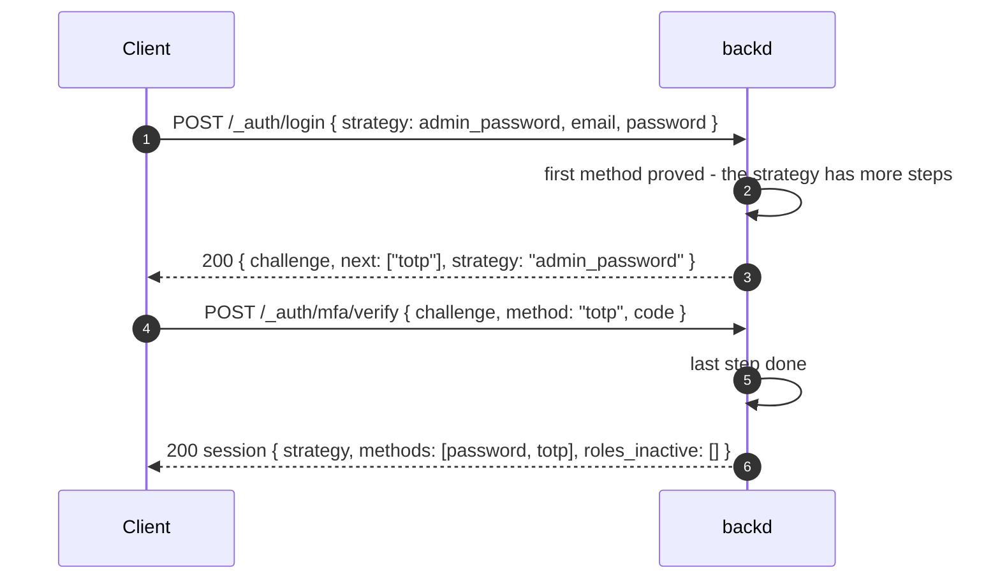

# Design: authentication strategies

- **Issues:** not created yet
- **Status:** decided (2026-11-12; §14 records the answers)
- **Changes:** [mfa-passwordless.md](./mfa-passwordless.md) (`mfa.required_roles` and the way a second step is chosen), [identity-providers.md](./identity-providers.md) (where `providers:` and `sign_in:` live), and `support_docs/decisions.md` (`auth:` as an enabled/disabled scalar; the top-level sign-in keys). The decisions are in §14; `support_docs/decisions.md` gets its lines in issue A1.
- **Comes before:** the passkeys design (`design/passkeys.md`, PR #917). Passkeys become one *method* of a strategy, which removes several of its open problems (§12).
- **Related designs:** [scoped-sessions.md](./scoped-sessions.md), [account-lifecycle.md](./account-lifecycle.md), [email-delivery.md](./email-delivery.md)

## 1. The idea

Today a realm has one sign-in shape. Every first factor (password, provider, magic link) is available to everyone, and the only knob is `mfa.required_roles`, which adds a TOTP step for some roles. That is not enough once a realm has different people and different clients:

- a customer on the web signs in with a passkey;
- an administrator in the terminal uses a password and a TOTP code;
- an administrator in the admin interface uses a password and a passkey;
- a mobile app uses a passkey, or a provider.

A **strategy** is a named, ordered list of methods that a person completes to sign in. The developer defines as many as the realm needs, and **roles say which strategies may use them**. The client picks the strategy it can perform.

```yaml
auth:
  strategies:
    users_password: [password]
    users_passkey:  [passkey]
    admin_password: [password, totp]
    admin_passkey:  [password, passkey]
```

Two questions are separate, and the design keeps them apart:

| Question | Answered by |
|---|---|
| *How* does this person prove who they are? | the **strategy** the client asked for |
| *What* may this session do? | the **roles** the strategy leaves active |

Standing rules carried over: no session in a URL; challenges hash-only with a TTL; nothing reveals who is registered where it can be hidden; API keys are not sessions and are not affected; no installed base worth protecting at 0.x, so breaking changes are allowed and listed first in the changelog.

## 2. Decisions at a glance

| Topic | Decision |
|---|---|
| Strategy | a name and an ordered list of **methods**; every method must succeed, in order; the session records the strategy it was made with |
| Methods | `password`, `passkey`, `totp`, `magic_link` and the name of any configured provider (`google`, `microsoft`, `apple`; generic OIDC later). `recovery_code` is not listed: it stands in for `totp` wherever `totp` appears. |
| Order | the **first** method is any method and identifies the person; **later** methods are only `password`, `totp` or `passkey` (an email code or a provider as a second step was rejected in the MFA design) |
| Who picks | the **client**, with a `strategy` field on the sign-in call; backd does not guess from the user agent |
| Roles | a role may list `strategies`; it is **active in a session** only when the session's strategy is in that list; no list means every strategy |
| Weaker strategy | signing in with a strategy a role does not allow still succeeds, **without** that role, and says which roles stayed inactive (§5) |
| Enrollment | a strategy that needs `totp` or `passkey` from someone who has none sends them to enroll it, as the forced enrollment of [mfa-passwordless.md §5.3](./mfa-passwordless.md) does today |
| Configuration | **all** sign-in settings live under `auth:` (§3); `mfa.required_roles` is removed |
| Disabled realms | `auth: disabled` stays as the one explicit way to run without authentication (§3.3) |
| Rules and functions | see `user.strategy`, `user.methods` and `user.mfa`; `user.roles` holds only the **active** roles |
| Existing behavior | **only the strategy decides the steps.** A user's own TOTP no longer adds one: "any user may turn TOTP on and is then always asked" ends, and the upgrade note says so (§6) |

## 3. Configuration (`realm.yaml`)

### 3.1 The shape

```yaml
auth:
  strategies:
    users_password: [password]
    users_passkey:  [passkey]
    admin_password: [password, totp]
    admin_passkey:  [password, passkey]

  signup: invite
  sessions: { idle_timeout: 14d, max_lifetime: 60d }
  password: { min_length: 14 }

  totp:
    enabled: true          # default; false: users cannot turn a second factor on
    issuer: Acme           # the name authenticator apps show (default: the realm's name)

  passkeys:
    enabled: true          # needed by every strategy that lists `passkey`
    rp_id: acme.example
    rp_name: "Acme"
    origins: [https://app.acme.example, https://admin.acme.example, "android:apk-key-hash:..."]

  magic_link:
    enabled: false
    signup: false

  sign_in:                 # shared by magic links, providers and the hosted pages
    allowed_redirects: [https://app.acme.example, "acme://"]
    app_url: https://app.acme.example/signed-in

  providers:               # as today, moved under auth
    google: { ... }

cors:
  origins: [https://app.example.com, http://localhost:5173]

roles:
  admin:
    description: Manages users and invitations
    admin: true
    users: [ops@example.com, { email: lead@example.com }]
    strategies: [admin_password, admin_passkey]
  editor:
    description: Can publish articles
    strategies: [users_password, users_passkey]
```

Two small differences from the draft this design started from: `sign_in:` sits under `auth:` and not inside `magic_link:` (providers and the hosted pages use it too), and `passkeys.enabled` is `true` because the strategies use it (§3.2 makes the other combination an error).

**What moves.** Everything that is about *who may sign in and how* goes under `auth:`: `signup`, `sessions`, `password`, `login_throttle`, `totp` (was `mfa`), `passkeys`, `magic_link`, `reauth`, `sign_in`, `providers`. The platform keys (`cors`, `email`, `push`, `storage`, `audit`, `locales`, `functions`) and `roles` stay where they are.

### 3.2 Startup checks

- every strategy is a non-empty list of **known methods**, each at most once;
- later methods are `password`, `totp` or `passkey` only; a first method may be any;
- a method must be configured: `passkey` needs `auth.passkeys.enabled`, `totp` needs `auth.totp.enabled`, `magic_link` needs `magic_link.enabled` and `email:`, a provider name needs that provider; otherwise the realm **does not start**, and the message names the strategy and the missing setting;
- `roles.<r>.strategies` names strategies that exist; a role with an empty list is an error (use no `strategies` key for "all");
- a realm with the admin interface or admin roles and **no** strategy that gives the admin role a second step is warned about outside dev mode, as the "no MFA for admins" warning is today;
- unknown keys under `auth:` are errors, not ignored (a typo must never turn authentication off, §3.3).

### 3.3 Disabled realms

Today `auth: disabled` makes a realm that has no users, keys or rules, with a startup warning, and it must never face the internet. Proposed: that stays **an explicit scalar**, `auth: disabled`; `auth:` with a map of settings and strategies is enabled; **a missing `auth` key, or a map with no `strategies`, is an error**, not "disabled". Reason: if "no strategies" meant "no authentication", one mistyped or deleted key would silently open a production realm. (The draft that started this design suggested removing the scalar; keeping the explicit `disabled` was chosen, §14.)

### 3.4 Migration (0.x, breaking)

| Today | New |
|---|---|
| `auth: enabled` | `auth:` with `strategies` |
| realm with password only | `strategies: { password: [password] }` |
| password + Google + magic link, any of them | `{ password: [password], google: [google], magic_link: [magic_link] }` |
| `mfa.required_roles: [admin]` | the admin role lists strategies that end in `totp` (or `passkey`): `admin_password: [password, totp]`, one per first method they use |
| `mfa:` | `auth.totp:` |
| top-level `sign_in:`, `providers:`, `magic_link:`, `signup:`, `sessions:`, `password:`, `login_throttle:`, `reauth:` | the same, under `auth:` |

A realm that relied on users turning TOTP on by themselves must now say where it applies: add `totp` to the strategies that need it. A realm.yaml in the old shape **fails to start** with a message that names the key and the new place; there is no silent compatibility layer (it would double the paths the tests must cover). The changelog lists this first under "Breaking", and a table like the one above goes in the upgrade note. The same commit migrates `internal/templates/files/realm.yaml`, every `examples/config/*/realm.yaml`, the tutorial and the docs pages that show the old keys (about 14 files carry an `auth:` line today, and the pages that show `mfa:` or `required_roles` are `docs/content/docs/build/auth/mfa.md`, `…/auth/_index.md`, `…/configuration/realm.md`, `troubleshooting.md` and the tutorial chapter on the second factor).

## 4. Signing in with a strategy

### 4.1 The client names the strategy

Every first-step route takes a `strategy`:

| Method | Route | Where `strategy` goes |
|---|---|---|
| `password` | `POST /_auth/login` | body |
| `passkey` | `POST /_auth/passkey/login/options` and `…/verify` (passkeys design) | body |
| `magic_link` | `POST /_auth/magic-link` | body; carried in the link's login code |
| a provider | `GET /_auth/oauth/{provider}/start` | query; carried in `state` |
| organization sign-in | the same routes under `/_auth/orgs/{org}/…` | as above |

- **Omitted:** allowed when **exactly one** strategy starts with that method, so a realm with one password strategy keeps working with today's calls. With more than one, the answer is `400 strategy_required`.
- **Not listed or wrong first method:** `400 unknown_strategy`, the same for both.
- `GET /_auth/strategies` (no auth) lists the strategy names and their methods so a client can draw its sign-in screen. It reveals no roles, users or settings; the names are in the app's code anyway.

### 4.2 Steps



- **One mechanism:** the MFA challenge of [mfa-passwordless.md §4.1](./mfa-passwordless.md) is generalized to "the next step of strategy X": same table, same 5 minutes and 5 attempts, the same limits; `mfa_required` becomes `next` (the methods the person may use now). A strategy with three steps simply issues the challenge again.
- **A step the person cannot do:** the strategy needs `totp` and they have none → the **enroll** challenge (§6). They have no passkey and the first method is `passkey` → the generic failure (the same as a wrong password).
- **A recovery code** is accepted wherever `totp` is the next step.
- **Single use, uniform failure, the throttles** are unchanged; the strategy name is part of the throttle key only for reporting.

### 4.3 What the session records

`strategy`, `methods` (the steps completed, in order) and `mfa`. Refreshing keeps all three. `user.mfa` is true when the session's methods hold **two or more different kinds** of method, or a user-verified `passkey` (the passkeys design settles that second case). No session survives a change of the strategy's definition in a way that raises its privileges: roles are recomputed from the strategy on every request (§5).

## 5. Roles and strategies

**A role is active in a session only if the session's strategy is allowed for it.** No `strategies` key means "all".

| User | Signs in with | Session |
|---|---|---|
| holds `admin` and `editor` | `admin_password` | `admin` active; `editor` not (its list has no admin strategy), unless `editor` lists it |
| holds `admin` and `editor` | `users_passkey` | `editor` active; `admin` **inactive** |
| holds only `admin` | `users_password` | signed in, with **no** active roles; `roles_inactive: ["admin"]` |
| holds no role | any strategy | signed in; every strategy is open to a role-less user |

- **Where it is applied:** once, where the session becomes a `Principal`. `user.roles` in rules and `ctx.user.roles` in functions hold the active roles, the admin API and the admin interface check the active `admin` role, and `isAdmin` follows. Nothing else reads a user's stored roles for access decisions.
- **Why sign in at all with an unlisted strategy?** The alternative, refusing, tells an attacker which roles an address holds and strands people who hold both a strong and a weak role. A session without the role is simply less powerful, and the response says what stayed inactive, **only after** the person has authenticated, so a client can offer "sign in with a stronger method".
- **A stronger strategy does not imply a weaker one's roles.** Listing is explicit: the sample lists the admin strategies on `admin` only, so an admin session does not carry `editor`. To give admins the editor role too, list the admin strategies on `editor` as well. This is more typing and no surprises.
- **API keys** are not sessions and are not touched: they carry their own scopes, and `X-Backd-On-Behalf-Of` keeps its meaning.

## 6. Enrollment and credentials

- **Adding credentials** (a TOTP secret, passkeys, a password) works as designed in [mfa-passwordless.md §5.2](./mfa-passwordless.md) and the passkeys design, for any signed-in user, with reauth. It is allowed when `auth.totp.enabled` or `auth.passkeys.enabled`.
- **Forced enrollment** is a result of the strategy: a person completing `admin_password: [password, totp]` without a TOTP secret gets the `enroll` challenge, which allows only the setup calls and then ends in the session. The same for a passkey step.
- **A login is complete when its strategy's steps are met, nothing more.** TOTP and passkeys are enrolled so that strategies listing them can be completed; a user's own enrollment never adds a step to another strategy. This ends today's opt-in (a regular user who turned TOTP on is asked for it on every sign-in): a realm that wants it for everyone writes it into the strategy (`users_password: [password, totp]`). Enrolling is therefore mostly something the strategy *requires* (forced enrollment, above), not something users choose on their own.
- **Reauth** proofs are unchanged: the strongest credential the user has (TOTP or recovery code or, with passkeys, a passkey; else the password; else an email code).
- **Disabling a method:** removing a strategy from the config takes effect on the next request (roles) and the next sign-in (steps); existing sessions keep their recorded strategy, and lose any role whose list no longer allows it.

## 7. Rules, functions and the admin surface

- Rules: `user.strategy`, `user.methods`, `user.mfa`, `user.roles` (active). Example: `write: user != nil && user.strategy == "admin_passkey"`.
- Functions: the same fields on `ctx.user`; test helpers (`testing.js`) take a `strategy` when they fake a user.
- Typed clients and generated types: `Strategy` as a string type with the realm's names as constants.
- The admin interface signs in with a configurable strategy (a dropdown when there are several admin strategies) and shows the session's strategy.
- `backd login --strategy <name>` (default: the only strategy that starts with a password, else it asks); `backd account strategies` lists them.
- Audit events carry the strategy (`login`, `login_failed`, `step_failed`).

## 8. Organizations and other realms

- In realms with organizations ([scoped-sessions.md](./scoped-sessions.md)) the org routes take `strategy` too; the strategy decides the steps and the organization the membership check, as the password sign-in does today. An organization's own **connection** (SSO) stays a separate way in and is not a strategy in this design; whether it should be is a follow-up.
- `auth: disabled` realms are untouched.

## 9. Limits and security considerations

- **A strategy is not a client check.** backd cannot know whether a request came from a browser, a terminal or an app (headers can be forged), so the design does not pretend to enforce "this strategy only on mobile". The boundary is the **role binding**: a session made with a weak strategy cannot hold a strong role, whoever asked. Passkeys add real client binding through their origin and relying party id.
- **Downgrade:** a person who can sign in with any strategy can always choose the weakest one that their roles allow. That is why high roles list only strong strategies, and why a strategy with a role listed nowhere gives that role to nobody.
- **No enumeration:** unknown strategy and wrong first method look the same; a missing credential looks like a wrong password; roles are revealed only after authentication.
- **Dev realms:** a development realm uses `strategies: { dev: [password] }`, with no second factor, and the startup warning for admins still applies outside dev mode (this is the "development realm without MFA" of the quickstart plan).
- **Typos:** unknown keys under `auth:` fail the start (§3.2), and there is no implicit disabled state (§3.3).

## 10. Where the code changes

- `internal/registry`: the `auth:` map, the moved keys, the strategy and role checks, the removed `mfa.required_roles`; the old shape produces the migration errors of §3.4.
- `internal/auth`: `afterFirstFactor` becomes "what is the next step of this strategy"; `VerifyMFA` and the enroll challenge take the strategy's remaining steps; `Principal` construction applies the role filter; the session stores `strategy`. This is the same refactor the passkeys design called P0, made larger and replacing it (§12).
- `internal/httpapi`: the `strategy` field on the first-step routes, `GET /_auth/strategies`, the `next` field of the challenge, `roles_inactive` on the session answer; `api/openapi.yaml` and the contract tests change in the same commits.
- Clients (JS, Dart, Go, Python), the CLI, the admin interface, the tutorial and the examples follow (§11).

## 11. Proposed issue split

| # | Step | Contents |
|---|---|---|
| A1 | Decide | this design decided; `decisions.md` updated (the `auth:` shape, the moved keys, the removed `mfa.required_roles`) |
| A2 | Configuration | the `auth:` map, the moved keys, startup checks, migration errors, the template and every example and docs page migrated. The engine does not exist yet, so a small **adapter** translates the parsed strategies to today's runtime (which first factors are available; roles whose strategies all end in `totp` become the old required roles) and A3 removes it; behavior is unchanged for realms migrated one-to-one |
| A3 | The engine | steps, the generalized challenge, the strategy on routes and sessions, role filtering at the principal, `GET /_auth/strategies`, `roles_inactive`; the old MFA becomes `[<first>, totp]` strategies |
| A4 | Rules and functions | `user.strategy`, active `user.roles`, `ctx.user`, test helpers, generated types |
| A5 | Clients, CLI and admin interface | `strategy` in the four clients, `backd login --strategy`, the admin interface, docs and tutorial |

Passkeys follow on this ([§12](#12-what-changes-in-the-passkeys-design)): their milestone is re-planned after A3.

## 12. What changes in the passkeys design

- A passkey is a **method**, not a "factor that is also a second factor". Where it sits in a strategy decides its role: `users_passkey: [passkey]` is a passwordless sign-in, `admin_passkey: [password, passkey]` is a second step.
- This removes problems found in its review: registering a passkey no longer silently turns on a second step for password sign-ins elsewhere; a user whose passkey is the second step of `admin_passkey` can still use `admin_password` in the CLI; recovery codes belong to `totp` only, and a strategy that needs a second step without TOTP has to say so.
- The `mfa: true` question becomes a configuration choice: `[passkey]` alone counts (user verified) and a developer who wants more writes `[password, passkey]`.
- **P0** of that design (`SecondFactorsOf`, `IsSecondFactor`, `Proof`, one challenge writer) is replaced by A3 here: "has MFA" stops being a lookup and becomes a property of the session's strategy.
- The `internal/auth/passkey` package pilot is unaffected: the protocol and storage do not depend on strategies.
- Issues #907–#916 are re-planned after this design is decided; none has started.

## 13. Alternatives considered

- **Keep `mfa.required_roles` and add passkeys to it:** it only expresses "this role also needs a second step", not "this role signs in with a passkey", and it has no place for different clients.
- **Strategy per client, enforced by backd:** rejected; backd cannot trust a client's claim about what it is (§9). Roles are the enforceable boundary.
- **Strategies chosen by backd from the user's roles:** rejected; the person with two roles would be forced into one flow, and a CLI could not choose a password flow where a browser uses a passkey.
- **Refusing a sign-in whose strategy no role of the user allows:** rejected; it leaks which roles an address has and strands people with mixed roles (§5).
- **Stronger strategies inheriting weaker ones' roles by a ranking:** rejected; rankings are opinions (is a passkey stronger than password+TOTP?). Explicit lists are longer and unambiguous.
- **Removing `auth: disabled` and treating "no strategies" as disabled:** rejected for safety (§3.3).
- **An `totp?` optional step, or adding any enrolled second factor to every strategy:** rejected (§14, question 3); the strategy is the whole definition of a login, and a hidden extra step is the kind of surprise this design removes.
- **A compatibility layer for the old keys:** rejected (§3.4).

## 14. Decisions taken (2026-11-12)

| # | Question | Decision |
|---|---|---|
| 1 | Disabled realms | `auth: disabled` stays as the explicit scalar; a missing `auth` or an `auth` map with no strategies is a **startup error** (§3.3) |
| 2 | A role the strategy does not allow | the person **signs in without the role**; the answer lists `roles_inactive` after authentication (§5) |
| 3 | A user's own TOTP | **strategies only.** A login is complete when its strategy's steps are met; a user's own TOTP adds nothing, and the opt-in behavior ends (§6). An optional step (`totp?`) was offered and declined |
| 4 | Where the keys live | **all** sign-in keys under `auth:`; platform keys and `roles` stay (§3.1) |
| 5 | Old keys | **fail to start** with a message that names the new place; no compatibility layer; Breaking in the changelog (§3.4) |
| 6 | Client binding | **none** in v1; roles are the boundary (§9) |
| 7 | Default strategy | omitted `strategy` works only when exactly one strategy starts with the method, else `400 strategy_required`; no `default_strategy` setting (§4.1) |
| 8 | Sign-up without a password strategy | today's password and magic-link sign-up stay; passkey sign-up is decided with the passkeys design |
| 9 | Order of work | **this design first (A1–A5), then the passkeys milestone re-planned on it** (§11, §12) |
