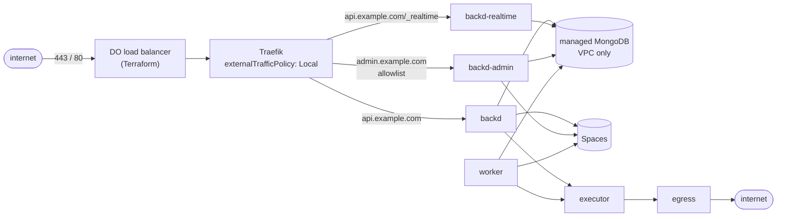

# Design: Kubernetes on DigitalOcean

- **Issues:** design #815 (39.1); Terraform #816–#822 (39.2–39.8); Helm chart #823–#825 (39.9–39.11); docs and CI #826 (39.12). Milestone `39-kubernetes-digitalocean`.
- **Status:** proposal, under review. Nothing is built.
- **Related:** the [production reference](../deploy/production/README.md) and its docs page (Operate → Production deployment), which this design maps onto Kubernetes; [Deploying config](../docs/content/docs/operate/deploying.md); [change-feed.md](../docs/content/docs/operate/change-feed.md) (realtime in production); [file-storage.md](./file-storage.md) and [public-files.md](./public-files.md).

## 1. The idea

Run `backd` on DigitalOcean Kubernetes (DOKS) with the same protections the Compose production reference has, and make the whole installation reproducible from two things kept in the repository:

- **Terraform** (`deploy/terraform/digitalocean`) builds the infrastructure and the cluster add-ons, and creates the Kubernetes Secrets from its own outputs.
- **A Helm chart** (`deploy/kubernetes/backd`) deploys `backd`. A pipeline builds an image of the realm configuration, pushes it to the DigitalOcean registry and upgrades the chart: **one configuration release is one image tag**.

The line between the two is a short, written contract (§7): Terraform never installs the chart, and the chart never creates infrastructure. Other providers later get `deploy/terraform/<provider>` and reuse the same chart.

## 2. Decisions at a glance

| Topic | Decision |
|---|---|
| Layout | `deploy/terraform/digitalocean` (+ `bootstrap/`), `deploy/kubernetes/backd` (chart), `deploy/kubernetes/scripts/`; a later provider is `deploy/terraform/<provider>` |
| Split | Terraform: infrastructure, add-ons, Secrets. Pipeline: the chart, on every configuration release |
| Configuration | **Baked into the image** (`FROM backd:<version>` + realm tree + built functions, `backd config check` at build time). Pods run with a read-only root filesystem. No volume, no ConfigMap |
| Release / rollback | A release is a new image tag; the rollout is the restart; rollback is `helm rollback` or the previous tag |
| Which workloads carry the configuration | `backd`, `backd-admin`, `worker` and the provisioning Job. **Not** the executor (it never sees `CONFIG_DIR`) and **not** egress: both run the released `ghcr.io/fernandezvara/backd-executor` / `backd` images |
| Registry | DigitalOcean Container Registry, tier a variable (`starter`, `basic` default, `professional`). One repository, images told apart by tag |
| Database | DigitalOcean managed MongoDB only: 1 node, or 3 (primary + 2 standby). Reachable from the VPC only |
| Files | 1 or 2 Spaces buckets (private, and optionally public), names chosen by the user |
| Traffic | **One** load balancer, requested by the ingress controller's Service and read back by Terraform. The ingress controller is **Traefik** (ingress-nginx was retired in March 2026). TLS by cert-manager (DNS-01 on DigitalOcean DNS) in the ingress |
| Admin | `backd-admin` (same image, admin API and UI on) on its own hostname, reachable from an IP allowlist kept in the ingress |
| Secrets | Generated by Terraform, created as Kubernetes Secrets from its outputs. The state lives in an encrypted private Spaces bucket |
| Replicas | Chart values: a global default and one per component |
| DNS | Records in a DigitalOcean domain that already exists, created from Terraform outputs |

## 3. The workloads

The chart maps the Compose reference one to one. All `backd` roles are the same binary; what differs is the command and a few settings.

| Workload | Image | Command | Needs the configuration | Notes |
|---|---|---|---|---|
| `backd` | config image | `serve` | yes | Public API. `BACKD_ADMIN_API=false`, `PROVISION_MODE=verify`, `BACKD_EVENTS=false`, `BACKD_TRIGGERS=false`. Scales freely |
| `backd-realtime` | config image | `serve` | yes | Same as `backd` with `BACKD_EVENTS=true` and `BACKD_TRIGGERS=true`: the only instances that read the change stream and the only ones that compete for the trigger dispatcher's lease (one holds it, the rest wait). `POST /v1/{realm}/_realtime` is routed here. A handful of replicas is enough (each holds one change stream, whatever the number of clients) |
| `backd-admin` | config image | `serve` | yes | `BACKD_ADMIN_API=true`, `BACKD_ADMIN_UI=true`. Its own Service and hostname. Manual function invocations call back to this Service |
| `worker` | config image | `worker` | yes | Async jobs and cron. It does **not** run the trigger dispatcher: only `serve` starts it (`startTriggers` in `cmd/backd/main.go`), so `worker` has no `BACKD_TRIGGERS` setting to make |
| `executor` | `ghcr.io/fernandezvara/backd-executor:<version>` | `executor` | **no** | One Deno process per call. NetworkPolicy: reaches only `backd`'s internal listener (`:8081`) and egress; no route to MongoDB, Spaces or the internet |
| `egress` | `ghcr.io/fernandezvara/backd:<version>` | `egress` | **no** | The only way out for functions and push (`EXECUTOR_PROXY`). Refuses private and link-local addresses except `backd:8081` |
| `provision` (Job) | config image | `backd provision` | yes | A Helm `pre-install`, `pre-upgrade` and `pre-rollback` hook (§4) with the **admin** database credentials (§6); the serving pods never have them |

Common to all: `readOnlyRootFilesystem`, `runAsNonRoot`, all capabilities dropped, no privilege escalation, `seccompProfile: RuntimeDefault`, resource requests and limits, `terminationGracePeriodSeconds` above `SHUTDOWN_TIMEOUT` (15 s), `/healthz` for liveness and `/readyz` for readiness, a PodDisruptionBudget (`maxUnavailable: 1`) once there is more than one replica, and topology spread over nodes. The executor gets an `emptyDir` (memory-backed) for `EXECUTOR_DIR`; its limits follow the Compose numbers (`EXECUTOR_MAX_PROCESSES` × ~260 MiB; `pids` limit where the cluster allows it).

Metrics: every process serves `/metrics` on `METRICS_ADDR` behind `METRICS_TOKEN`. The chart ships a `ServiceMonitor` (off by default) and the alert rules of the reference as an optional `PrometheusRule`; installing a monitoring stack is not part of this milestone.

### Replicas

```yaml
replicas:
  default: 2          # used by every component that doesn't name its own
  backd: ~            # ~ = default
  backdRealtime: 2
  backdAdmin: 1
  worker: 1
  executor: ~
  egress: 1
```

`default` exists because the user asked for one knob; the explicit keys exist because the components don't scale the same way (the admin instance rarely needs more than one; the executor follows job volume). Rules the chart enforces: `backdAdmin` and `egress` may be 1; `backd`, `backdRealtime` and `executor` below 2 render a warning, not an error (a single-node development cluster is legitimate).

## 4. Configuration is the image

This is the project's standing position (Deploying config): the configuration and the built functions are part of the image, so every container of a deployment runs exactly the same one and `PROVISION_MODE=verify` can refuse a mismatch.

```dockerfile
FROM ghcr.io/fernandezvara/backd:<version>
COPY config /config
ENV CONFIG_DIR=/config
RUN ["/backd", "config", "check"]
```

The functions are built in a build stage that has Deno (`backd functions build --check`), as in `deploy/production/app/Dockerfile`; an invalid configuration or stale bundle fails the **build**, never the deploy.

### The release pipeline

An example GitHub Actions workflow (issue #825) does, for a tag or a merge to the configuration repository:

1. build the config image and run `backd config check` (inside the build);
2. push it to the registry as `<registry>/<name>:<release>` (the release is a git tag or a short sha);
3. `helm upgrade --install … --set image.tag=<release> --atomic --wait`. The `provision` hook runs first, with the **new** image, so the database matches the configuration before any pod of the new release starts, and serving pods start in `verify` mode;
4. on failure, `--atomic` rolls the chart back. **A rollback is not safe by itself**, and the code says why: `PROVISION_MODE=verify` compares the database with the image's own configuration (collections, validators, indexes) and then its fingerprint with the one the last provisioning recorded (`Provisioner.Verify`, `verifyFingerprint`). After a newer release was provisioned, a pod of the previous image that starts refuses to (`ErrConfigMismatch`). The chart therefore runs the `provision` Job as a hook on **`pre-install`, `pre-upgrade` and `pre-rollback`**: a rollback first provisions the old configuration again, then the old pods start and verify. Provisioning is idempotent and, as the code shows, additive for collections (an unknown collection only warns); validators are replaced by the old release's. Two consequences the docs state: during a rollout a pod of the *old* release that restarts (a drained node, a crash) fails verification until the rollout completes, and a rollback across a change that stored data the older validator rejects (a field the old schema forbids) needs the data fixed first.

Because the image tag is part of the pod template, the rollout *is* the restart. No `kubectl rollout restart` is needed.

### The registry and the Starter tier

DigitalOcean's registry tiers differ in repositories, not tags. Starter has **one repository** (and 500 MiB), Basic five, Professional unlimited. With the executor and egress taken from `ghcr.io`, the only image the install pushes is the config image, so **a single repository is enough** on every tier. Releases are tags of that repository, e.g. `acme-prod:2026-10-30-1`.

- Storage fills with old tags. The design requires a retention routine: the pipeline deletes tags beyond the last N (default 10) after a successful rollout, then runs the registry's garbage collection. The Starter tier's 500 MiB makes this necessary; with a ~50 MiB image and N = 10 it fits only barely, so the docs say to lower N on Starter.
- The cluster pulls through the registry integration that Terraform enables (no per-namespace credential to manage); a pull Secret is also created for namespaces the integration doesn't cover.
- Pulling the base images from ghcr is public and needs no credential. If a user mirrors them into the registry, that is a second repository and needs Basic.

## 5. Traffic, TLS and the admin allowlist



- **One load balancer**, requested by the ingress controller's Service (its size, algorithm and name are the Terraform variables, passed as `service.beta.kubernetes.io/do-loadbalancer-*` annotations) and **read back by Terraform by name** for the DNS records and the node firewall. Terraform does not create it itself: DigitalOcean's cloud controller owns a load balancer made for a Service and rewrites its rules, so a Terraform-made one would drift. It passes TCP through (`80` and `443` to the node ports) with the PROXY protocol, so TLS ends in the ingress, where cert-manager's certificates live, and the client's address survives; the Service also names the API host (`do-loadbalancer-hostname`) so a pod that reaches the public address from inside the cluster goes through the load balancer and sends the header too.
- **No open port on the nodes.** The cluster's cloud firewall allows inbound traffic only from the load balancer and the VPC; nodes have no public SSH. Egress from the nodes is open (image pulls, Let's Encrypt, DNS API) — functions are separately confined by NetworkPolicy and the egress proxy.
- **The real client address** must reach `backd` and the ingress rate limiter. The ingress Service uses `externalTrafficPolicy: Local` (a node without an ingress pod fails the load balancer's health check and gets no traffic), and `TRUSTED_PROXIES` on every `backd` workload is the private ranges (`10.0.0.0/8,172.16.0.0/12,192.168.0.0/16,fc00::/7`), the value `docker-compose.dev.yml` already uses. That is safe here because a NetworkPolicy lets only the ingress controller's pods reach `backd` and `backd-admin`, so no other source can present a private address. `X-Forwarded-For` is set by the ingress from the connection, never believed from the client. The value is a chart value for clusters with a narrower pod range.
- **TLS:** cert-manager with a `ClusterIssuer` using DNS-01 on DigitalOcean DNS, a scoped API token in a Secret. HTTP redirects to HTTPS; HSTS is set by the ingress.
- **Rate limits and body size** come from the numbers in `deploy/production/nginx/backd.conf.template`: `auth` 10 requests a minute with burst 5, `func` 2 a second, everything else 20 a second with burst 40, 20 connections per address, 1 MiB body, 60 s read timeout, and 1 h with buffering off for `_realtime`. Traefik applies limits as `Middleware` objects attached per route, so one `IngressRoute` carries a route per traffic class (auth, functions, realtime, default) with its own `rateLimit`, `inFlightReq` and `buffering` middlewares (the body limit), keyed on the client address. Traefik has no equivalent of nginx's total-request deadlines: the `websecure` entry point reads a request within ten minutes and never times out writes (realtime streams).
- **Public host and admin host.** The public Ingress never routes `/v1/{realm}/_admin` or `/_ui` (those paths answer 404 at the edge, and the public `backd` serves neither anyway). The admin route sends everything to `backd-admin`.
- **The admin allowlist** is an `ipAllowList` Middleware on the admin route, fed from `ingress.admin.allowedCIDRs`. **An empty list fails the render**; it never opens the host. `deploy/kubernetes/scripts/admin-allow.sh <cidr>[,<cidr>]` patches the Middleware in place without a release; the next `helm upgrade` keeps the value (the script also updates a ConfigMap the chart reads, or the pipeline is given the new value; see §12, item 10).
- **If the address changed and the admin host refuses you:** the allowlist concerns HTTP to that hostname only. `kubectl` and Terraform talk to the Kubernetes and DigitalOcean APIs and are unaffected; `kubectl port-forward svc/backd-admin 8081:8080` reaches the admin instance directly.
- **A realm with `auth: disabled`** must never be internet-facing. The chart can't know the configuration (it is in the image), so the check lives in the **pipeline**: `backd config check` already warns about such a realm, and the example workflow fails the build when it sees the warning on a production install. A developer who really means it comments that step out; the guide calls that dangerous mode. (§12, item 6.)

## 6. The database

A DigitalOcean managed MongoDB with 1 node, or 3 (primary and two standby). The cluster has no public address in this setup: it sits in the VPC and its trusted sources are the cluster.

What `backd` needs from MongoDB (Operate → Requirements): a replica set (for change streams: realtime and triggers), the change-stream privilege, and — for the reference's least-privilege model — per-collection grants.

- **Connection:** `MONGO_URI` carries the replica set, `tls=true` and the managed cluster's CA, mounted from a Secret (`tlsCAFile`); `SSL_CERT_FILE` is not needed.
- **Two users:** a read-write user for the serving pods (`PROVISION_MODE=verify`) and `doadmin`, which only the `provision` Job uses (`backd provision` in the config image). Terraform creates the first and the Secrets for both.
- **Least privilege is not available on DigitalOcean.** Its documentation says users cannot be created or changed with `mongosh`, ACLs cannot be managed, and a new user gets the permissions of `doadmin` (the API can make it read-write or read-only, nothing finer). The per-collection grants of `deploy/production/ops/grants.js` and a custom role therefore **cannot be applied**, and this design drops them for this provider:
  - serving pods use a **read-write user** created by Terraform; the `provision` Job uses `doadmin`. The two users still separate *who may start*: a pod in `verify` mode never changes the schema on its own, but the database user *can*. This is a weaker posture than the Compose reference and `docs/content/docs/auth/security.md` and `SECURITY.md` say so;
  - the compensations are the network ones: the database is reachable from the cluster only, and a NetworkPolicy lets only `backd`, `backd-admin`, `backd-realtime`, `worker` and the `provision` Job open connections to it (the executor and egress can't);
  - the audit and invocation history collections are append-only in the reference through grants; here they are not, and the docs say it.
  This was read from DigitalOcean's limits page, not tried: the spike in #818 confirms it first (§12, item 1).
- **1 node versus 3:** one node is the default and the docs show how to go to three. Whether a one-node DigitalOcean cluster is a replica set (backd refuses standalone servers, and realtime and triggers need change streams) is not stated in the pages read; the spike in #818 checks it and, if it is not, the variable offers 3 only. With three nodes the URI lists the members and gets `w=majority`; a one-node cluster has no failover and a maintenance window means downtime. Going from one to three is a change of `database_nodes` in Terraform plus a rolling restart (the new `MONGO_URI` is in the Secret); the guide has the steps. The chart does not change: `MONGO_URI` lists what Terraform outputs. `w=majority` and `retryWrites=true` are part of the URI for the 3-node case.
- **Backups:** managed backups are enabled by Terraform (retention a variable). The reference's encrypted `mongodump` job is out of scope; the docs say which of the two to use.

## 7. The contract between Terraform and the chart

Terraform creates the namespace and these objects; the chart only reads them (names are values, these are the defaults, `<n>` is the install name).

| Secret / ConfigMap | Keys | Created from | Read by |
|---|---|---|---|
| `backd-mongo` | `MONGO_URI` (app user), `MONGO_ADMIN_URI` (admin user), `ca.pem` | managed MongoDB outputs | serving pods: `MONGO_URI`, `ca.pem`; `provision`: `MONGO_ADMIN_URI` too |
| `backd-keys` | `BACKD_SECRETS_KEY`, `BACKD_EXECUTOR_TOKEN`, `BACKD_CALLBACK_KEY`, `BACKD_EGRESS_KEY`, `BACKD_METRICS_TOKEN` | `random_password` | each workload gets only the keys it uses (the executor never gets `BACKD_CALLBACK_KEY` or `BACKD_SECRETS_KEY`) |
| `backd-registry` | `.dockerconfigjson` | registry credentials | image pull |
| `backd-install` (ConfigMap) | `BACKD_URL`, `BACKD_ENV`, `BACKD_DEPLOYMENT_ID`, the API and admin hostnames, the Spaces endpoints and bucket names, the public base URL | outputs | the chart's values and the pipeline |
| `external-dns-token` / `cert-manager` token | DigitalOcean API token, scoped to DNS | variable | cert-manager only |

**The Spaces access keys are not pod Secrets.** In `backd` the storage keys are *realm secrets* (`access_key: secret:STORAGE_ACCESS_KEY` in `realm.yaml`), stored encrypted in MongoDB under `BACKD_SECRETS_KEY` and set with `backd secret set` through the admin API, not read from the environment. Terraform outputs them as sensitive values; setting them is a step of the first install (§8), after the first administrator exists, and rotating them is `backd secret set` again — no restart. The configuration in the image therefore names the buckets (`bucket`, `prefix`, `endpoint`/`region`, `url`), which come from the `backd-install` ConfigMap *at build time*: the pipeline renders them into the realm configuration, or the example keeps them in the repository, and the guide says which is the supported way (§12, item 11).

Terraform outputs, as a list: `kubeconfig` (sensitive), `cluster_id`, `registry_endpoint` and a push credential (sensitive), `load_balancer_id` and `load_balancer_ip`, the hostnames, `mongo_uri` and `mongo_admin_uri` (sensitive) and `mongo_ca`, `spaces_private` and `spaces_public` (name, endpoint, region, public URL), and the two Spaces keys (sensitive).

## 8. Secrets: where they live, how they rotate

| Secret | Created by | Lives in | Rotation |
|---|---|---|---|
| Terraform state (everything below) | — | a **private, versioned Spaces bucket** with its own scoped key; created by `bootstrap/` first | key rotation in the DigitalOcean panel |
| `BACKD_SECRETS_KEY` | Terraform (`random_password`) | state, Secret `backd-keys` | `backd secret rotate-key` (re-encrypts the stored secrets), then `terraform apply -replace=random_password.secrets_key`; **losing it makes the stored realm secrets unreadable** |
| Executor, callback, egress, metrics tokens | Terraform | state, Secret `backd-keys` | `terraform apply -replace=…`, then restart the affected workloads (the doc says which, and in which order: the executor token changes on `backd` and the executor at once) |
| MongoDB users | Terraform | state, Secret `backd-mongo` | `-replace` the user; restart |
| Spaces keys (private and public) | Terraform | state; **realm secrets in MongoDB** | `-replace` the key, then `backd secret set` — no restart |
| Registry push credential | Terraform | state; the pipeline's CI secret | `-replace`; update the CI secret |
| DNS token | the user | state, Secret | in the DigitalOcean panel |
| Admin IP allowlist | the user | the release's values | `admin-allow.sh` |
| The first administrator | `backd bootstrap` | MongoDB | — |

What a lost state costs: the infrastructure remains but Terraform can't manage it, and `BACKD_SECRETS_KEY` is unrecoverable unless it is also kept elsewhere. The guide says to **copy `BACKD_SECRETS_KEY` to a password manager once**, and that a Secret is only base64: etcd encryption at rest is DigitalOcean's (managed control plane), and anyone with `get secrets` in the namespace reads them — RBAC for the namespace is documented. Security-relevant statements go to `docs/content/docs/auth/security.md` and `SECURITY.md` with #826.

The first install order is: bootstrap bucket → `terraform apply` → DNS delegation check → pipeline's first release → `backd bootstrap` (first administrator, from the `backd-admin` pod) → `backd secret set` for the Spaces keys → `backd storage check`.

## 9. Terraform layout

```
deploy/terraform/digitalocean/
  bootstrap/        the private state bucket and its key (applied once, local state)
  versions.tf       pinned providers (digitalocean, kubernetes, helm, random)
  variables.tf  outputs.tf
  network.tf        VPC, cloud firewall
  cluster.tf        DOKS, node pool(s)
  database.tf       managed MongoDB, users, trusted sources
  spaces.tf         1 or 2 buckets, CORS, lifecycle, scoped keys, CDN
  registry.tf       registry (tier), integration, credentials
  loadbalancer.tf   the load balancer
  dns.tf            records
  addons.tf         Traefik, cert-manager, ClusterIssuer (helm_release)
  secrets.tf        namespace, random secrets, Kubernetes Secrets
```

Variables (names are the proposal): `install`, `region`, `kubernetes_version`, `node_size`, `node_count` (+ `autoscale_min/max`), `ha_control_plane`, `database_nodes` (validated: 1 or 3), `database_size`, `buckets` (`private` / `private_and_public`) with `private_bucket_name` and `public_bucket_name`, `public_cdn`, `registry_tier` (`starter`/`basic`/`professional`, default `basic`), `load_balancer_size`, `domain`, `api_host`, `admin_host`, `assets_host`, `dns_ttl`, `admin_allowed_cidrs` (used only for the first install's output; the chart owns it afterwards).

Rules: every resource carries the `install` name and a `backd` tag so several installs share an account; sensitive outputs are marked; `terraform fmt -check` and `validate` run in CI; providers are pinned.

## 10. Cost and sizing defaults

Defaults reproduce the setup discussed: 2 nodes of 2 vCPU / 4 GB, one load balancer, managed MongoDB 1 node 2 GiB, one private bucket, registry `basic`. Monthly, from DigitalOcean's pricing pages at the time of writing (to be confirmed before the docs state them): nodes $48, load balancer $12, MongoDB $30.51 (1 node, 2 GiB) or $91.53 (3 nodes), Spaces $5, registry $5 (Basic) or $0 (Starter) — about $100 to $160 a month. The guide carries a table by option and says what each variable changes.

## 11. What is not in this milestone

- A monitoring stack (Prometheus/Grafana). Metrics endpoints, ServiceMonitor and alert rules are provided.
- Log shipping, a service mesh, a WAF in front of the load balancer.
- Self-run MongoDB (Droplet or in-cluster): managed only.
- Other providers (the layout leaves room), other ingress controllers, ArgoCD/Flux (the chart works with them; the example pipeline uses `helm`).
- Multi-region and disaster recovery beyond the managed backups.

## 12. Decisions taken in review, and what is still open

Decided:

1. **No custom roles** on DigitalOcean's MongoDB (§6): a read-write service user and `doadmin` for provisioning, with the weaker posture stated in the security pages. To be confirmed by the spike in #818 (it is read from DigitalOcean's documentation).
2. **One node by default,** as a replica set, with the move to three documented (§6).
3. **The trigger dispatcher runs on `backd-realtime`** (`serve` with `BACKD_TRIGGERS=true`); `worker` never runs it (§3).
4. **The ops image:** today only `backd` and `backd-executor` are published (`release.yml`, `.goreleaser.yaml`); `deploy/production/ops` is built from the repository. With no custom roles there is no `grants.js` to run, so the `provision` Job needs only `backd provision` and runs in the config image. No ops image is needed.
5. **Rollback** needs the `pre-rollback` provisioning hook (§4); it is not safe without it.
6. **The `auth: disabled` guard is in the pipeline** (§5): the example workflow fails the build when the check warns about such a realm on a production install. A developer who really means it comments that step out, which the guide calls dangerous mode.
7. **The pod CIDR** is the private ranges of `docker-compose.dev.yml`, with a NetworkPolicy (§5).

Still open, each with the issue that settles it:

8. **A 1-node DigitalOcean cluster as a replica set** (#818 spike).
9. **Resolved in #821:** the ingress controller is Traefik, not ingress-nginx (retired March 2026: no releases, no security fixes), and the load balancer is requested by its Service and read back by name, not adopted. The `externalTrafficPolicy: Local` health checks and the PROXY protocol are checked in the deployment test.
10. **How `admin-allow.sh` persists its value** across `helm upgrade`: it edits the Middleware and the same value in the release's values, or the pipeline passes the CIDRs from a CI variable. Proposed: the script updates a ConfigMap the chart reads with `lookup` (#824).
11. **Storage settings in `realm.yaml`:** the bucket names, region and public `url` are Terraform outputs but live in the configuration inside the image. Proposed: the configuration repository holds them and `terraform output` prints a `storage:` block to paste (#825, #826).
12. **Spaces keys scoped to one bucket:** the provider is believed to support per-bucket grants; if the pinned version does not, the key is account-wide and the docs say so (#819).
