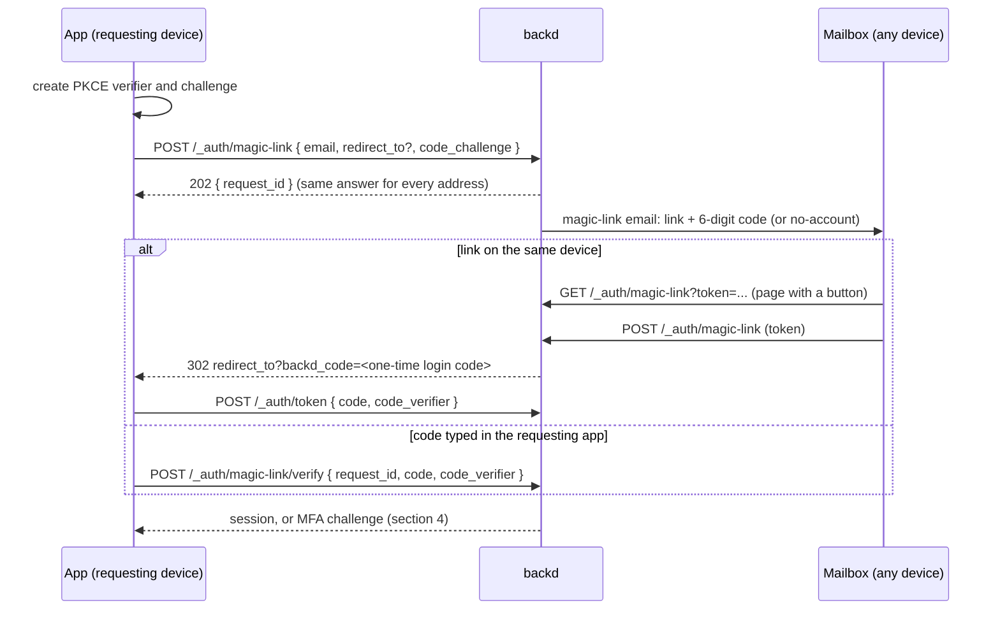

# Design: multi-factor authentication and magic links

- **Issues:** features 13.1–13.11 (milestone `13-mfa-passwordless`)
- **Status:** decided
- **Related designs:** [account-lifecycle.md](./account-lifecycle.md) (password reset, email change, deletion, revocation), [email-delivery.md](./email-delivery.md) (tokens, hosted pages, templates, limits, `allowed_redirects`), [identity-providers.md](./identity-providers.md) (identities, one-time login codes, PKCE)

## 1. The idea

Both features extend the password sign-in that already exists. They don't replace it.

- **Magic links** are one more **first factor**, next to passwords and providers. They prove the user controls the mailbox, which is the same strength as the password reset backd already has.
- **MFA** is a **second step** after any first factor. It's built once and shared by passwords, providers and magic links.

Standing rules carried over:

- **No session in a URL.** Sessions travel only in `Authorization: Bearer`. Links end in a one-time login code redeemed with PKCE, as in the provider flow.
- **Secrets are encrypted per realm, and tokens are stored hash-only.**
- **Nothing reveals who is registered** where it can be hidden.
- **No installed base,** so breaking changes to endpoints are allowed (§9).
- **Docs and tests are part of every issue.**

## 2. Decisions at a glance

| Topic | Decision |
|---|---|
| Two steps | every first factor answers with an **MFA challenge** (5 minutes, hash-only, 5 attempts) instead of a session when the user has MFA; `POST /_auth/mfa/verify` issues the session |
| Factors | **TOTP** (`github.com/pquerna/otp`) and **10 recovery codes**; passkeys later in their own design; no email or SMS codes as second factor |
| Who uses MFA | optional for users; `mfa.required_roles` forces it, with enrollment completing the sign-in; the template requires it for admin roles; a startup warning outside dev mode otherwise |
| Lost factor | recovery codes, else an **admin reset** (never self, a CLI path for single-admin realms); no reset by email |
| Sensitive actions | one **re-authentication** step (`POST /_auth/reauth`) giving a 5-minute token for `X-Backd-Reauth`; endpoints no longer take `password` |
| Magic links | the email carries **a link** (same device, PKCE-bound login code) **and a 6-digit code** (typed in the requesting app on any device); 10 minutes, single use |
| Link users | any verified user; sign-up only when `magic_link.signup` and the realm allow it; passwords become optional; the last sign-in method can't be removed |
| Limits | 5 attempts per challenge; 10 failed second factors per user per hour, then `429` for 15 minutes; login throttle per IP; single-use TOTP steps; `mfa-failed` alert |
| CLI and keys | `backd login` prompts and enrolls in the terminal, and supports `--magic-link`; API keys bypass MFA by design, but creating, rotating or widening them needs reauth |
| Sessions | record their methods; rules see `user.mfa` and `user.methods`, functions see `ctx.user.mfa` and `ctx.user.methods`; enabling MFA revokes other sessions; no trusted devices |

## 3. Configuration (`realm.yaml`)

The template writes these sections **commented**, explaining each key.

The keys are **top level** in `realm.yaml`, next to `providers:` and `sign_in:` ([identity-providers.md §3](./identity-providers.md#3-configuration-realmyaml)). `auth:` stays the `enabled`/`disabled` switch, so none of this lives under it.

```yaml
sign_in:                              # already exists (identity-providers.md); one key is added
  allowed_redirects: [https://app.acme.example, "acme://"]
  app_url: https://app.acme.example   # the app's address; fallback destination for browser sign-ins without redirect_to
mfa:
  enabled: true                       # users may turn on TOTP (default true)
  issuer: "Acme"                      # name shown in authenticator apps (default: realm name)
  required_roles: [owner]             # roles that must use MFA, or "all"; the template lists the realm's admin roles
magic_link:
  enabled: false                      # needs email:
  signup: false                       # unknown addresses may create a verified account
reauth:
  ttl: 5m                             # re-authentication token lifetime
```

**Startup checks:**
- `magic_link.enabled` without `email:` fails;
- `mfa.required_roles` must name roles the realm declares;
- `sign_in.app_url` must be within `sign_in.allowed_redirects` (or, when absent, `email.allowed_redirects`).

**Finishing browser sign-ins (no special app route):** everything backd serves stays under `/v1/{realm}/_auth/…` (the magic-link page, provider callbacks, hosted pages). The app declares no return route:
- the JS client sends the **current page** as `redirect_to` when it starts a magic link or a provider sign-in, so the user comes back where they were;
- backd redirects there with the one-time login code in a `backd_code` query parameter, or `backd_error` (plus `backd_provider` for `account_exists`) on failure, and `backd_linked=<provider>` after a successful link; the `backd_` prefix keeps them from colliding with the app's own parameters;
- on load, the JS client detects `backd_code`, redeems it with its PKCE verifier through `POST /v1/{realm}/_auth/token`, removes the `backd_*` parameters from the address bar with `history.replaceState`, and continues. Apps without the JS client do the same three steps by hand, as documented;
- requests without `redirect_to` (for example a link requested from a device with no browser page) fall back to `sign_in.app_url`, the realm's single app address (when neither exists, `start` answers `400 invalid_redirect`);
- mobile apps use their app schemes in `redirect_to`, within `allowed_redirects`, as before.

This also applies to provider sign-ins: the rename of the parameters, the generic login code, `sign_in.app_url` and the completion on load are built in Phase 9 (issues 7.12i, 7.12j and 7.12k), before this milestone starts.

**Startup warning, outside dev mode:** a realm whose admin roles aren't in `required_roles` is warned about, next to the existing "no admin user" warning.

**Without `email:`:** MFA still works, but security notices aren't sent, and reauth by email code and magic links aren't available.

## 4. Two-step sign-in (issue 13.1)

### 4.1 Challenges

Every first factor runs the same check after it succeeds:

| User state | Answer |
|---|---|
| no MFA, role doesn't require it | session, as today |
| MFA enabled | `200 { mfa_required: true, challenge, methods: ["totp", "recovery_code"] }` |
| role requires MFA, none enrolled | `200 { mfa_enrollment_required: true, challenge }` (§5.3) |

The first factors are:
- `POST /_auth/login` (password);
- the login-code redeem used by providers and magic links (§7.4);
- `POST /_auth/oauth/{provider}/id-token`.

**Storage:** challenges are stored in `<realm>___system.auth_challenges`, keyed by SHA-256, with a TTL. Each one holds:
- `kind` (`mfa` or `enroll`);
- the user id;
- the first factor (`pwd`, `link`, `google`, …);
- `redirect_to` and the one-time profile when they came from a provider;
- `attempts`, `expires_at` (5 minutes) and `used_at`.

**Verification:** `POST /_auth/mfa/verify { challenge, method, code }`.
- **Success:** issues the session, marks the challenge used, and answers exactly like the first factor would have (`new_user` and `profile` for providers). When a recovery code was used, the answer includes `recovery_codes_left`.
- **Failure:** `400 invalid_code` with `attempts_left`. After 5 attempts, or once expired, the answer is `400 invalid_challenge`. Unknown, used and expired challenges look identical.

### 4.2 Sessions remember how they were created

> **Extended by [scoped-sessions.md](./scoped-sessions.md) §4.1:** in realms with organizations a session also has its `org`, the scope. MFA challenges carry the organization.

- **Recorded methods:** sessions store `methods`, the first factor plus `totp` or `recovery` when MFA was used, and `mfa: true|false`. Refreshing keeps them.
- **Rules:** they see `user.mfa` and `user.methods` next to the existing `user` fields, for example `read: user != nil && user.mfa && hasRole("finance")`. Functions see the same in `ctx.user.mfa` and `ctx.user.methods`. API keys and `X-Backd-On-Behalf-Of` calls have `user.mfa: false` and `user.methods: ["key"]`. Anonymous callers have no `user`, so rules guard with `user != nil` as they already do.
- **Revocation:** enabling MFA revokes every **other** session of the user, so a session created before MFA can't pass rules that require it.
- **No trusted devices** and no "remember this device".

## 5. TOTP and recovery codes (issues 13.2 and 13.3)

### 5.1 TOTP

- **Library:** `github.com/pquerna/otp`. Settings are SHA-1, 6 digits and 30-second steps, the values every authenticator app supports, with a 160-bit secret.
- **Storage:** `<realm>___system.mfa`, one document per user. The secret is encrypted with the realm key (AES-256-GCM). The document also holds `enabled_at` and `last_step`.
- **Validation:** a code is checked against steps t−1, t and t+1. The matching step must be greater than `last_step`, which is then updated atomically. A code is accepted once at most, and an older one can't follow a newer one.

### 5.2 Enrollment and management

All of these act on the signed-in user and require `X-Backd-Reauth`, except the forced enrollment in §5.3.

| Endpoint | Behavior |
|---|---|
| `GET /_auth/mfa` | `{ enabled, methods, recovery_codes_left, required }` |
| `POST /_auth/mfa/totp/setup` | Creates a pending secret (15 minutes) and returns `{ setup_id, secret, otpauth_uri, qr }`. `qr` is a PNG data URI made from the library's key image. |
| `POST /_auth/mfa/totp/confirm { setup_id, code }` | Activates TOTP, returns `{ recovery_codes }` **once**, revokes the user's other sessions and sends a `security-notice` (`mfa-enabled`). |
| `DELETE /_auth/mfa/totp` | Disables MFA and deletes the recovery codes. Answers `403 mfa_required_by_role` when a role requires MFA. Sends `security-notice` (`mfa-disabled`). |
| `POST /_auth/mfa/recovery-codes` | Replaces every recovery code, returns the new ones once and sends `security-notice` (`recovery-codes-regenerated`). |

**Enabling also needs reauth**. Otherwise someone holding a stolen session could turn MFA on with their own phone and lock the real user out.

**Recovery codes:**
- 10 codes of 10 characters from an unambiguous alphabet, shown as `xxxxx-xxxxx`;
- stored as HMAC-SHA-256 with the realm key, each usable once;
- using one sends a `security-notice` (`recovery-code-used`) with the number left.

### 5.3 Required by role

- **Forced enrollment:** a user in a required role (or every user, with `all`) who has no MFA gets an `enroll` challenge after the first factor. It allows only:
  - `POST /_auth/mfa/totp/setup { challenge }`;
  - `POST /_auth/mfa/totp/confirm { challenge, setup_id, code }`, which returns the recovery codes **and** the session, with `methods` including `totp`.
- **Existing sessions** of such users keep working until they expire. `backd user mfa status --realm <r>` lists users in required roles without MFA.
- **Role changes:** adding a required role to a user doesn't revoke their sessions. Their next sign-in enrolls them.

## 6. Recovery and re-authentication (issues 13.4 and 13.5)

### 6.1 Admin reset

- **How:** `backd user mfa reset --realm <r> --user <u>` and `POST /_admin/users/{id}/mfa/reset`.
- **What it does:** removes TOTP and recovery codes, revokes **all** of the user's sessions, sends `mfa-reset` and is audited. Users in required roles enroll at their next sign-in.
- **Not on yourself:** an admin can't reset their own MFA (`403 self_reset_not_allowed`).
- **Single-admin realms:** `backd user mfa reset --local` runs on the instance with direct access to the database and the master key, and is audited as `instance`. The docs describe it as the break-glass path.
- **No reset by email.** A self-service recovery with a waiting period is a backlog item.

### 6.2 Re-authentication

> **Sessions opened through an organization's connection** cannot do the account-level actions in the list below (`403 sso_session`); see [scoped-sessions.md](./scoped-sessions.md) §7.

`POST /_auth/reauth` takes the strongest proof the user has:

| User has | Accepted proof |
|---|---|
| MFA | `{ method: "totp" or "recovery_code", code }` (a password alone is not enough) |
| a password, no MFA | `{ method: "password", password }` |
| neither | `{ method: "email_code", code }` after `POST /_auth/reauth/email-code` sends a 6-digit code (`reauth-code` email, 10 minutes, 5 attempts) |

- **Result:** `{ reauth_token, expires_at }`. The token is hash-only, bound to the current session, valid for `reauth.ttl` (5 minutes) and reusable within that time, so a settings page can make several changes after one prompt.
- **Requiring it:** sensitive endpoints require `X-Backd-Reauth` and answer `401 reauth_required` without it. Their `password` body fields are **removed**. The sensitive endpoints are:
  - MFA enable, disable and recovery-code regeneration;
  - password change and removal;
  - email change (`POST /_auth/email`);
  - account deletion (`DELETE /_auth/me`);
  - unlinking a provider (`DELETE /_auth/identities/{provider}`);
  - creating, rotating or widening API keys.
- **Notification:** each sensitive action is audited and notifies the user by email.
- **Failures count:** failed reauth attempts count toward the same limits as sign-in (§8).

## 7. Magic links (issues 13.6 and 13.7)

### 7.1 Flow



### 7.2 Rules

- **Request record:** `<realm>___system.auth_challenges` (kind `magic_link`), keyed by `request_id`. It holds:
  - the link token's hash and the code's hash;
  - the PKCE challenge and `redirect_to`;
  - the user id, or the address encrypted when it's unknown and sign-up is allowed;
  - `attempts`, 10 minutes of validity and single use.

  Redeeming the link or the code consumes the request, so the other stops working.
- **Same answer always:** `202 { request_id }` in similar time, for known, unknown and blocked addresses. Requests use the email limits (per recipient and per IP).
- **Link:** the hosted page follows the email rules: GET shows a button and POST acts, so mail scanners can't use up the link, with the same headers, log scrubbing and one error page. After POST it redirects to `redirect_to` (from the request, checked against `allowed_redirects`), else `sign_in.app_url`, else a page saying "go back to the app and type the code". The redirect carries the one-time login code in `backd_code`, bound to the request's PKCE challenge, and the JS client finishes the sign-in on whatever page it lands (§3).
- **Wrong device:** opening the link elsewhere reaches an app without the PKCE verifier. The JS client reports `wrong_device`, and the docs show the message "open this on the device where you asked, or type the code from the email".
- **Code:** `POST /_auth/magic-link/verify { request_id, code, code_verifier }`, 5 attempts. It also needs the verifier, so the code only works in the app that made the request.
- **Templates:** `magic-link` (link, code, expiry) and `no-account`, in every listed locale.

### 7.3 Who can use them

- **Known addresses:** any user with a verified email. Completing a link or code also verifies an unverified user, since only the mailbox owner could do it.
- **Unknown addresses:** with `signup: true` and the realm's sign-up open, the account is created **verified** when the link or code is redeemed, never at request time. It answers with `new_user: true` and runs `account.on_signup` like provider sign-ups. With `signup: false` or sign-up closed, a `no-account` email is sent ("someone tried to sign in with this address; there's no account").
- **Existing account sessions:** the login gate (`require_verified_email`) is satisfied by definition.
- **MFA:** a user with MFA gets the challenge after the link or code.
- **Identity:** users signing in by link have an `email` identity recorded at the first link sign-in, so "last sign-in method" checks treat links like any other method. `email` (like `password`) is a reserved provider name, so a generic OpenID Connect provider can't take it (7.12j).

### 7.4 Login codes are generic (built in Phase 9, issue 7.12i)

The one-time login code of the provider flow is already generic when this milestone starts: `<realm>___system.login_codes` and `POST /_auth/token { code, code_verifier }`, with the first factor (`method`: the provider's name) stored on the code. Magic links add the `link` method; the redeem step ends in the MFA challenge when needed (§4.1). `POST /_auth/oauth/token` and `oauth_codes` no longer exist.

### 7.5 Passwordless accounts

- **Removing the password:** `DELETE /_auth/password` with reauth removes the password identity. It refuses with `409 last_sign_in_method` when no other method remains. A method counts as remaining when it is a provider identity, or a verified email with magic links enabled.
- **Adding one back:** a passwordless user sets a password with `POST /_auth/password` (reauth) or through password reset.
- **Account settings:** `GET /_auth/me` lists the available methods (`password`, `magic_link`, providers) so apps can build an account settings page.

## 8. Limits

| What | Limit |
|---|---|
| attempts per MFA challenge, magic-link code, reauth code | 5 |
| failed second factors per user (TOTP, recovery, reauth codes) | 10 per hour, then `429 mfa_locked` with `Retry-After` for 15 minutes, counted across challenges in the existing counters (`mfa:user:<id>`) |
| per IP | the existing login throttle covers login, `mfa/verify`, `magic-link/verify` and `reauth` |
| magic-link and reauth-code emails | the email limits per recipient and per IP |
| TOTP replay | each time step once (`last_step`) |

**Alert:** after 3 wrong codes following a correct password, the user gets `mfa-failed` ("your password was used to sign in, but the code was wrong; change your password"), at most once per hour.

**No account lockout** that needs an admin, so knowing a password never lets someone lock a user out for good.

## 9. Endpoints (new or changed)

| Method and path | Purpose |
|---|---|
| `POST /_auth/login` | may answer with `mfa_required` or `mfa_enrollment_required` |
| `POST /_auth/mfa/verify` | finish sign-in with TOTP or a recovery code |
| `GET /_auth/mfa` | status |
| `POST /_auth/mfa/totp/setup`, `POST /_auth/mfa/totp/confirm` | enroll (reauth, or an `enroll` challenge) |
| `DELETE /_auth/mfa/totp` | disable (reauth) |
| `POST /_auth/mfa/recovery-codes` | regenerate (reauth) |
| `POST /_auth/reauth`, `POST /_auth/reauth/email-code` | re-authenticate |
| `POST /_auth/magic-link` | request a link and code |
| `GET`, `POST /_auth/magic-link` | hosted page |
| `POST /_auth/magic-link/verify` | redeem the code |
| `POST /_auth/token` | redeem a one-time login code (replaces `/_auth/oauth/token`) |
| `POST /_auth/password`, `DELETE /_auth/password` | set or remove the password (reauth) |
| `POST /_auth/email`, `DELETE /_auth/me`, `DELETE /_auth/identities/{provider}` | now require `X-Backd-Reauth` instead of `password` |
| `POST /_admin/users/{id}/mfa/reset` | admin reset |
| admin API key routes | creating, rotating or widening keys requires `X-Backd-Reauth` |

**New codes:** `invalid_code`, `invalid_challenge`, `mfa_locked`, `mfa_required_by_role`, `reauth_required`, `self_reset_not_allowed`, `last_sign_in_method`, `magic_link_disabled`.

**Endpoint changes in other designs:** 4.6, 4.8 (email change), unlinking providers (`DELETE /_auth/identities/{provider}`, built in #142/#215, today without a password) and the API key routes lose their `password` fields or require reauth. `POST /_auth/oauth/token` has already moved to `/_auth/token` (7.12i). Issues already on GitHub must be edited by hand.

## 10. Emails

| Template | When |
|---|---|
| `magic-link` | link and code requested for a known address, or an unknown one with sign-up allowed |
| `no-account` | link requested for an unknown address without sign-up |
| `reauth-code` | passwordless reauth |
| `mfa-reset` | an admin reset the user's MFA |
| `mfa-failed` | 3 wrong codes after a correct password (once per hour) |
| `security-notice` | one template with an `event` value: `mfa-enabled`, `mfa-disabled`, `recovery-codes-regenerated`, `recovery-code-used`, `password-removed`, `password-set`, `api-key-created` |

All templates are localized and checked at startup like the other emails. They are required only when their feature is enabled.

## 11. CLI (issue 13.8)

- **`backd login`:**
  - asks for the TOTP or recovery code when challenged;
  - runs forced enrollment in the terminal: prints the `otpauth://` URI and a QR code drawn with block characters from the same image, asks for a code, then shows the recovery codes once and asks the user to confirm they saved them;
  - with `--magic-link`, asks for the address and then the code from the email.
- **The CLI user's own MFA:** `backd account mfa status|enable|disable|recovery-codes`, each running reauth by prompting.
- **API keys:** creating, rotating or widening scopes (7.2) prompts for reauth. The docs say plainly that keys bypass MFA by design and must be scoped and rotated.
- **Admin reset:** `backd user mfa reset` and its `--local` break-glass form (§6.1).

## 12. JavaScript client, example app and Shelf tutorial (issues 13.9 and 13.10)

**Client:**
- `client.auth.signIn()` returns either a session or `{ mfaRequired, challenge, methods }` or `{ enrollmentRequired, challenge }`;
- `client.auth.verifyMfa(challenge, method, code)`;
- `client.auth.mfa.status()`, `setup()`, `confirm()`, `disable()` and `regenerateRecoveryCodes()`;
- `client.auth.reauth()`: a helper takes a callback that asks the user for the right proof and retries the sensitive call once on `reauth_required`;
- `client.auth.magicLink.request(email)` (PKCE handled, current page as `redirect_to` unless `redirectTo` is given), automatic completion on load when `backd_code` is present (shared with providers; reports `wrong_device` when the verifier is missing), and `verifyCode(code)`;
- `client.auth.password.set()` and `remove()`.

**Example app:** magic-link sign-in, an account page with MFA setup (QR code, confirmation, recovery codes) and MFA required for its admin role.

**Shelf tutorial:** a new chapter adds:
- magic-link sign-in with sign-up enabled;
- MFA setup from the account page;
- MFA required for the tutorial's admin role;
- a rule that requires `user.mfa` for an admin-only collection;
- reauth before deleting the account;
- local testing with the Mailbox.

The tutorial's tests cover the new steps.

## 13. Security considerations

- **No half sessions:** a challenge is not a session, and only `mfa/verify` and enrollment accept it.
- **No user enumeration:** magic-link requests answer the same for every address, and MFA is revealed only after a correct first factor.
- **Replay and guessing:** single-use TOTP steps, 5 attempts per challenge, per-user lock across challenges, per-IP throttle.
- **Lockout without help:** limits are temporary and admins can't reset themselves; the break-glass path needs the instance.
- **Recovery isn't a bypass:** no email reset; recovery codes are hashed with a key and notify the user when used.
- **Stolen sessions:** enabling, disabling and every other sensitive action need reauth. Enabling MFA revokes other sessions. Rules can require `user.mfa`.
- **Links:** scanner-safe GET and POST, PKCE-bound login codes, no sessions in URLs, the code works only in the requesting app.
- **API keys:** the documented bypass, guarded by reauth on creation, rotation and widening.
- **At rest:** TOTP secrets encrypted per realm; challenges, codes and reauth tokens stored hash-only; audit records hold ids only.

## 14. Audit events

`user.mfa_enabled`, `user.mfa_disabled`, `user.mfa_reset` (with the admin, or `instance`), `user.recovery_codes_regenerated`, `user.recovery_code_used`, `user.mfa_locked`, `user.password_set`, `user.password_removed`, `user.reauth` (method only), `user.signup` (`method: link`), `apikey.created`, `apikey.rotated` and `apikey.scopes_changed` (each with the reauth method).

## 15. Documentation

- **"Multi-factor authentication" guide:** two-step sign-in, enrollment, recovery codes, required roles, admin reset and break-glass, rules with `user.mfa`.
- **"Magic links" guide:** the same-device link and any-device code, PKCE, sign-up, passwordless accounts, wrong-device handling.
- **"Re-authentication" guide:** which proof applies to which user, the list of sensitive endpoints, the client helper.
- **Configuration reference and commented `realm.yaml` template:** `mfa`, `magic_link`, `reauth` and `sign_in.app_url`.
- **Security model page:** limits, the API key bypass, why there is no email reset and no trusted devices.
- **`api/openapi.yaml`:** every new or changed endpoint and code.
- **CLI reference** and the Shelf tutorial chapter.

## 16. Issues

| id | Issue | Depends on |
|---|---|---|
| 13.1 | Two-step sign-in and session methods | — |
| 13.2 | TOTP enrollment and recovery codes | 13.1 |
| 13.3 | MFA required by role | 13.2 |
| 13.4 | Re-authentication for sensitive actions | 13.2, 4.2 |
| 13.5 | Admin MFA reset | 13.2, 4.2 |
| 13.6 | Magic links | 13.1, 4.2f, 7.12i, 7.12j |
| 13.7 | Passwordless accounts | 13.4, 13.6 |
| 13.8 | CLI: MFA, magic links and reauth for API keys | 13.3, 13.4, 13.6, 7.2 |
| 13.9 | MFA and magic links in the JavaScript client and example app | 13.7, 4.7, 7.12k |
| 13.10 | MFA and magic links in the Shelf tutorial | 13.9 |
| 13.11 | Security review of MFA and magic links | 13.8, 13.10 |

## 17. Alternatives considered

- **Partial sessions or both factors in one request:** rejected. One adds a flag every route must check; the other reveals a correct password and doesn't fit providers or links.
- **Passkeys now:** deferred to their own design. **Email or SMS second factors:** rejected; an email code adds nothing after a magic link, and SMS is weak and needs a new channel.
- **Optional-only MFA, or one realm-wide switch:** rejected in favor of roles.
- **Self-service reset by email, now or per realm:** rejected for now; a waiting-period flow is in the backlog.
- **A password in each sensitive endpoint, or "recent sign-in" as proof:** replaced by one reauth step.
- **Cross-device approval:** rejected as a phishing pattern. **Links that work anywhere:** rejected because they give sessions to whoever holds the email.
- **Magic links for existing users only, or passwordless-only realms:** rejected as too narrow.
- **Locking accounts until an admin acts:** rejected because it lets attackers lock users out.
- **Browser device flow for the CLI; forbidding API keys under MFA:** rejected for now.
- **Trusted devices:** rejected as another long-lived credential.

## 18. Follow-ups

- Passkeys (WebAuthn) as a second factor and a passwordless method, in their own design.
- Self-service MFA recovery by email with a waiting period, if consumer apps need it.
- Admin UI: MFA status on users, the admin reset, the account settings page *(to add to the admin UI issues)*.
- The hosted sign-in page (#158) gains the MFA step and magic links.
- Shorter sessions for admins (7.29) pair well with required MFA.
