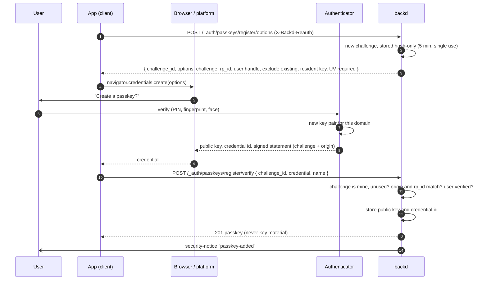

# Design: passkeys (WebAuthn)

- **Issues:** milestone `41-passkeys` (#907–#916), to be re-planned on [auth-strategies.md](./auth-strategies.md) (§15)
- **Status:** decided (2026-11-12; §16 records the answers). Two things are verified in the first step of the work, not assumed: the library's licence and API, and the browser test authenticator (§15, P1).
- **Builds on:** [auth-strategies.md](./auth-strategies.md) (**decided; comes first**: a passkey is one *method* of a strategy) and [mfa-passwordless.md](./mfa-passwordless.md) (challenges, reauth, recovery, limits). That design deferred passkeys to this one.
- **Related designs:** [scoped-sessions.md](./scoped-sessions.md) (sessions in realms with organizations), [account-lifecycle.md](./account-lifecycle.md), [email-delivery.md](./email-delivery.md) (hosted pages, `allowed_redirects`), [identity-providers.md](./identity-providers.md), [admin-ui.md](./admin-ui.md)

## 1. The idea

A passkey is a key pair kept by the user's device, password manager or security key. The private key never leaves it; backd stores only the public key. Signing in is a signature over a challenge backd issues, bound to the website's domain, so a phishing site cannot collect anything that works on the real one.

In backd a passkey is a **method** that strategies list ([auth-strategies.md](./auth-strategies.md)). Where it sits in the list is what it does:

| In a strategy | Example | What it is |
|---|---|---|
| **first and only step** | `users_passkey: [passkey]` | passwordless sign-in; the user is verified on the device (PIN or biometric), so one ceremony proves possession **and** the person |
| **a later step** | `admin_passkey: [password, passkey]` | a phishing-resistant second step after a password (or a provider, or a magic link) |
| **a proof for re-authentication** | `POST /_auth/reauth` | the same ceremony, bound to the current session |

Standing rules carried over: no session in a URL; nothing reveals who is registered where it can be hidden; challenges are hash-only with a TTL and used once; docs and tests are part of every issue.

**What this is not:** a way to create an account from a passkey alone (§16, question 2), attestation or hardware allow-lists (§16, question 4), email-first sign-in (§16, question 3), or a way to sign in with a passkey from the CLI (§11).

## 2. Decisions at a glance

| Topic | Decision |
|---|---|
| Library | [`github.com/go-webauthn/webauthn`](https://github.com/go-webauthn/webauthn), the maintained Go implementation; its licence and API are checked first (§15, P1). Its parsing and verification are not worth rewriting; a CBOR/COSE bug is a security bug. |
| Where it lives | a **new package `internal/auth/passkey`** (the protocol and credential storage, a leaf that does not import `auth`), with thin glue in `internal/auth` for sessions, limits and notices; storage in `internal/mongodb`; HTTP in `internal/httpapi/auth_passkeys.go`. It is also the pilot for splitting `auth` (§14). |
| Configuration | `auth.passkeys:` in `realm.yaml`, **off by default**; relying party id and origins explicit or derived (§3). A strategy that lists `passkey` while it is off fails the start. |
| Credentials | per user in `<realm>___system.passkeys`; several per user, named, removable (§4). Registration asks for a **resident (discoverable) key**, so every passkey works in any position. |
| Attestation | `none`; no make-and-model proof is asked or kept (decided, §16). |
| User verification | **required** in every ceremony. |
| First step | **discoverable credentials only**: the call takes no email, so it cannot reveal who is registered (decided, §16). |
| `user.mfa` | a user-verified passkey counts as `mfa: true`; sessions also record `passkey_synced` for rules that want a hardware key (§7.3; decided, §16). |
| Later step | the next step of the strategy offers `passkey`; the same ceremony with the user already known (§7.1). |
| Required for roles | by **role strategies** ([auth-strategies.md §5](./auth-strategies.md)); `mfa.required_roles` no longer exists. |
| Recovery codes | belong to `totp` only. Registering a passkey generates none (§9). |
| Other sign-ins | registering a passkey **changes nothing** about how the same person signs in with other strategies. |
| Sign-up | passkeys are **added** after another sign-in; no account is created from a passkey alone (decided, §16). |
| Management | register, rename and remove need `X-Backd-Reauth`; at most 10 per user; each change sends a `security-notice` (§8). |
| CLI | no passkeys in `backd login` (decided, §16); `backd account passkeys list|remove` exist. |
| Clients | JS does the whole ceremony through `navigator.credentials`; Dart delegates it to the platform; Go and Python manage and verify but cannot sign in with an authenticator (§11). |
| Tests | a software authenticator in Go tests; Playwright's virtual authenticator for browser tests (§12). |

## 3. Configuration (`realm.yaml`)

The template writes the section **commented**, with each key explained.

```yaml
auth:
  passkeys:
    enabled: true                      # needed by every strategy that lists `passkey`
    rp_id: acme.example                # the domain passkeys are bound to (default: the host of auth.sign_in.app_url)
    rp_name: "Acme"                    # shown by the browser when registering (default: realm name)
    origins:                           # where the ceremony may run (default: the origin of auth.sign_in.app_url)
      - https://app.acme.example
      - https://admin.acme.example
      - android:apk-key-hash:...       # native apps, see below
```

**The relying party id is permanent in practice.** A passkey belongs to its `rp_id` for life; change it and every registered passkey stops working, with no migration (the browser will not offer them). The docs say this next to the key. The id must be the app's domain, or a parent of it, never the API host unless the app is served from there too. Each credential stores the `rp_id` it was registered under, and the **startup log warns** when the configured value differs from the stored ones.

**Startup checks:**
- `auth.passkeys.enabled` needs `rp_id` (explicit or derivable) and at least one origin;
- every origin is `https://`, except `http://localhost` and loopback addresses in dev mode (`BACKD_DEV`);
- every web origin's host equals `rp_id` or is a subdomain of it (the browser enforces the same, so a mismatch is a config error found at start rather than a failed sign-in);
- origins are within `auth.sign_in.allowed_redirects` or `auth.sign_in.app_url`;
- a strategy that lists `passkey` while `enabled` is false is an error ([auth-strategies.md §3.2](./auth-strategies.md)); the reverse (enabled, no strategy lists it) is allowed and logged as a note, since passkeys can then be registered but not used.

**Native apps:** Android origins are `android:apk-key-hash:<base64url sha256 of the signing cert>`; iOS apps use the `rp_id` through *associated domains* and add no origin. backd serves nothing for either; the app owner publishes `/.well-known/assetlinks.json` and `apple-app-site-association` on the `rp_id` domain, and the docs say so.

**The hosted pages** (magic link, hosted sign-in #158) are served by backd, so they can use passkeys only when backd's host is within `rp_id`. When it is not (backd on a different registrable domain from the app), the page hides the passkey button and the docs explain why.

## 4. Storage

`<realm>___system.passkeys`, one document per credential:

| Field | Notes |
|---|---|
| `_id` | backd id |
| `user_id` | the owner |
| `credential_id` | binary, **unique index**; the authenticator's id |
| `public_key` | COSE key, as returned by the library; public, so not sealed |
| `rp_id` | the relying party id it was registered under (for the startup warning, §3) |
| `sign_count` | last seen counter (§6.3) |
| `transports` | `usb`, `nfc`, `ble`, `internal`, `hybrid`; sent back as hints at sign-in |
| `aaguid` | authenticator model id; shown to the user as a name when known |
| `backup_eligible`, `backup_state` | whether the passkey syncs; refreshed at every sign-in, shown in the UI (§7.3) |
| `name` | what the user calls it ("Phone", "YubiKey"); defaults from the AAGUID or the user agent |
| `created_at`, `last_used_at` | |

**User handle.** WebAuthn needs a stable opaque id per user that reveals nothing. It is a random 32-byte value stored on the user document (`passkey_handle`), created at the first registration and never the user id or email. Discoverable sign-in finds the user from it.

**Ceremony state.** Challenges live in the existing `auth_challenges` collection, hash-only, 5 minutes, single use, with new kinds `passkey-register` and `passkey-login`, and a TTL index. They keep the library's session data (the challenge, the user handle, the allowed credentials and the verification requirement).

**Sessions.** A session made with a passkey records `passkey_synced` (the backup-eligible flag of the credential used) next to the `strategy`, `methods` and `mfa` of [auth-strategies.md §4.3](./auth-strategies.md); refreshing keeps it.

## 5. The ceremonies

Every ceremony has two calls: `options` (the server issues a challenge) and the second call with the authenticator's answer (the server verifies it). The JSON follows the WebAuthn specification's `PublicKeyCredentialCreationOptions` and `…RequestOptions`, so a client passes the `options` to the browser unchanged and returns the result unchanged. Binary fields are base64url, as in the specification.

**The three actors.** The *app* (the JS client, or the platform code in Dart) only relays data. The *authenticator* (device, password manager or security key) holds the private key and signs only after the user verifies. *backd* holds the public key and issues one-time challenges. Nothing secret travels to backd: it receives a signature, and checks it with a public key.

### 5.1 Registration (signed in, with reauth)



### 5.2 A strategy whose first step is a passkey, e.g. `users_passkey: [passkey]`

```mermaid
sequenceDiagram
    autonumber
    participant U as User
    participant A as App (client)
    participant B as Browser / platform
    participant K as Authenticator
    participant S as backd

    A->>S: POST /_auth/passkey/login/options { strategy: users_passkey } (no email, no auth)
    S->>S: new challenge, stored hash-only (5 min, single use)
    S-->>A: { challenge_id, options: challenge, rp_id, UV required, no allowCredentials }
    A->>B: navigator.credentials.get(options)
    B->>U: pick an account
    U->>K: verify (PIN, fingerprint, face)
    K->>K: sign (challenge + origin + counter) with the private key
    K-->>B: assertion (credential id, user handle, signature)
    B-->>A: credential
    A->>S: POST /_auth/passkey/login/verify { challenge_id, credential }
    S->>S: find public key by credential id; user handle matches?
    S->>S: signature valid? challenge mine and unused? origin and rp_id? user verified? counter?
    S->>S: account checks as for every first step; consents to accept?
    alt all good and the strategy is complete
        S-->>A: session (strategy, methods: [passkey], mfa: true, passkey_synced, roles_inactive) or a consent challenge
    else all good and the strategy has more steps
        S-->>A: { challenge, next: [...] }
    else anything wrong
        S-->>A: 401 invalid_passkey (the same for every cause)
    end
```

### 5.3 A strategy whose later step is a passkey, e.g. `admin_passkey: [password, passkey]`

```mermaid
sequenceDiagram
    autonumber
    participant A as App (client)
    participant B as Browser / platform
    participant S as backd

    A->>S: POST /_auth/login { strategy: admin_passkey, email, password }
    S-->>A: { challenge, strategy: admin_passkey, next: ["passkey"] }
    A->>S: POST /_auth/mfa/passkey/options { challenge }
    S-->>A: { options } (allowCredentials: this user's passkeys)
    A->>B: navigator.credentials.get(options)
    Note over B: the user verifies; the authenticator signs
    B-->>A: credential
    A->>S: POST /_auth/mfa/verify { challenge, method: passkey, credential }
    S->>S: same checks as 5.2, plus the challenge's attempts and the per-user limit
    S-->>A: session (strategy: admin_passkey, methods: [password, passkey], mfa: true)
```

Re-authentication (§7.4) is the same shape as 5.3: options bound to the current session, then the credential in `POST /_auth/reauth`.

## 6. A passkey as the first step

### 6.1 Flow

1. `POST /_auth/passkey/login/options { strategy }` (no auth, no email) → `{ challenge_id, options }` with `userVerification: "required"` and an empty `allowCredentials`. `strategy` follows [auth-strategies.md §4.1](./auth-strategies.md): optional when exactly one strategy starts with `passkey`. It answers the same whether or not anyone has a passkey, so it reveals nothing.
2. The browser asks the user to pick an account and verify (PIN, fingerprint, face), or offers it in the username field through *conditional UI* (`mediation: "conditional"`).
3. `POST /_auth/passkey/login/verify { challenge_id, credential }`.
   - The server finds the credential by `credential_id`, checks that its user handle matches, verifies the signature, the origin, the `rp_id` hash, the challenge and that user verification happened, then updates `sign_count`, `last_used_at` and the backup flags.
   - **The same account checks as the password sign-in:** banned or erased users are refused, and so are unverified addresses when the realm has `RequireVerifiedEmail`; a failure is the same generic answer.
   - The strategy engine continues: if `passkey` was the last step, the sign-in ends through `finishSignIn` with `methods: ["passkey"]` and `mfa: true`: a session, or the **consent challenge** when the realm's consents are pending, exactly as for every other sign-in. If the strategy has more steps (`[passkey, totp]`), the answer is the challenge for the next one.
4. **Any failure** is `401 invalid_passkey`, whatever the reason (unknown credential, bad signature, wrong origin, expired challenge, user banned). The reason goes to the audit log, not to the caller.

### 6.2 Realms with organizations

In realms with organizations a session is scoped to one of them, and sign-in happens through `/_auth/orgs/{org}/…` ([scoped-sessions.md §5](./scoped-sessions.md)). The passkey routes follow: `POST /_auth/orgs/{org}/passkey/login/options` and `…/verify`. The server verifies the passkey as above, then applies the same membership check as the password sign-in, with the same uniform failure for a non-member. A passkey belongs to the **user**, not to an organization, so one passkey signs in to each organization the person belongs to.

### 6.3 Sign counters and cloned keys

Synced passkeys report a counter of 0 forever; hardware keys count up. So:
- a counter of 0 stays 0 and is not an error;
- a counter that goes **down** or repeats when it was above 0 means a possibly cloned key: the sign-in **still fails** (`invalid_passkey`), the credential is flagged in the audit log, and the user gets a `security-notice` (`passkey-clone-suspected`). The user removes the passkey or keeps it; backd does not delete it on its own.

### 6.4 Limits

- **Failures** count in the existing throttles: the per-IP login throttle covers `passkey/login/*`, and a failure for a known credential counts toward the per-user `mfa:user:<id>` counter (10 per hour, then `429 mfa_locked`). Failed attempts on unknown credentials count only per IP. Attempts per challenge: 1 (a ceremony that fails is started again; the browser makes that cheap).
- **`options` calls** need no authentication and each stores a challenge, so they are limited too: the per-IP throttle counts every call (not only failures), outstanding challenges per IP are capped, and a TTL index removes them after 5 minutes. A flood therefore costs the attacker's quota, not unbounded storage.

## 7. A passkey as a later step, and elsewhere

### 7.1 Within a strategy

When the strategy's next step is `passkey`, the challenge says `next: ["passkey"]` and the person:

1. `POST /_auth/mfa/passkey/options { challenge }` → `{ options }`, with `allowCredentials` listing **this user's** credentials (the first step already revealed the user, so there is nothing left to hide).
2. `POST /_auth/mfa/verify { challenge, method: "passkey", credential }`: `credential` is a new field next to `code`; exactly one of them is present, as the method requires.

A wrong ceremony is `400 invalid_code` like a wrong TOTP code and counts against the challenge's 5 attempts and the per-user limit. The session records the steps in `methods`, for example `[password, passkey]`. A user who has **no** passkey gets the enroll challenge (§7.2) when the strategy needs one.

### 7.2 Enrollment through the strategy

A person completing `[password, passkey]` with no passkey gets the `enroll` challenge of [auth-strategies.md §6](./auth-strategies.md), which additionally allows:
- `POST /_auth/mfa/passkey/register/options { challenge }`;
- `POST /_auth/mfa/passkey/register/verify { challenge, credential, name }`, which returns the **session** (a passkey step generates no recovery codes, §9).

### 7.3 What `user.mfa` means, and synced passkeys

A user-verified passkey counts as `mfa: true` (decided, §16, question 1): the ceremony proves possession of the device and the person. A passkey kept in iCloud Keychain or a Google account, though, can be used from every device on that account, and its strength is the strength of that account. backd therefore exposes what it knows so a rule can be stricter:

- `user.methods` contains `passkey`, and `user.strategy` names the strategy;
- `user.passkey_synced` is `true` when the passkey used is backup eligible (flag from the authenticator, refreshed at each sign-in); absent otherwise;
- a rule for the most sensitive data can require `!user.passkey_synced`, forcing a hardware key. The docs show the example. A developer who wants more than a single passkey for a role writes `[password, passkey]` in the strategy.

### 7.4 Re-authentication

`POST /_auth/reauth` gains `method: "passkey"`. It works in two calls: `POST /_auth/reauth/passkey/options` (session-bound, `allowCredentials` from the user's passkeys) and then `POST /_auth/reauth` with `{ method: "passkey", credential }`. The proof table ([mfa-passwordless.md §6.2](./mfa-passwordless.md)) becomes: TOTP, recovery code **or passkey** for a user who has any, else the password, else an email code. A user with a passkey may use it even without TOTP.

## 8. Managing passkeys

All of these act on the signed-in user, and the registration and removal need `X-Backd-Reauth`. Sessions opened through an organization's connection answer `403 sso_session`, like the other account-level actions.

| Endpoint | Behavior |
|---|---|
| `GET /_auth/passkeys` | `[ { id, name, created_at, last_used_at, transports, backup_eligible, backup_state } ]`; never the key material |
| `POST /_auth/passkeys/register/options` | creates the registration challenge; `excludeCredentials` lists the user's existing credentials so one device is not registered twice; `authenticatorSelection` requires a resident key and user verification (so an old security key that cannot store one cannot register; the docs say so) |
| `POST /_auth/passkeys/register/verify { challenge_id, credential, name }` | stores the credential; sends `security-notice` (`passkey-added`); **does not** revoke other sessions and changes nothing about how the user signs in elsewhere |
| `PATCH /_auth/passkeys/{id} { name }` | rename; no reauth needed |
| `DELETE /_auth/passkeys/{id}` | removes it; refuses when it is the user's last way to sign in at all (`last_sign_in_method`), or when the user holds an `admin` role and it is the only credential that lets them complete any strategy that role allows (`credential_required`); sends `security-notice` (`passkey-removed`) and revokes the other sessions that were opened **with that passkey** |

At most 10 passkeys per user (`passkey_limit`). `GET /_auth/mfa` gains `passkeys: <count>`.

**Why registration needs reauth.** Otherwise a stolen session could add the thief's own passkey and keep access after the password changes. Enabling TOTP needs it for the same reason ([mfa-passwordless.md §5.2](./mfa-passwordless.md)).

**Admin support:** `DELETE /_admin/users/{id}/passkeys/{passkey_id}` removes one passkey (audited, notifies the user), next to the full reset of §9.

## 9. Recovery

- **Lost device, synced passkey:** nothing to do; the passkey is on the user's other devices.
- **Lost device, device-bound passkey:** the user signs in with another strategy their roles allow (password, magic link, provider) and removes the lost passkey. **A role whose only strategies need a passkey has no way back**, so the docs advise keeping a second strategy for admins, for example `admin_password: [password, totp]` next to `admin_passkey`.
- **Recovery codes** belong to `totp`: they stand in for a TOTP code wherever a strategy asks for `totp`, and are generated when TOTP is enrolled. A passkey step has none.
- **Admin reset** (`POST /_admin/users/{id}/mfa/reset`, `backd-server user mfa-reset`, including the `--local` break-glass) removes **TOTP and passkeys**, revokes all sessions and sends `mfa-reset`. Users whose strategy needs a step enroll it at the next sign-in.
- **No new recovery path.** A passkey adds no weaker route than the ones that exist.

## 10. Endpoints (new or changed)

| Method and path | Purpose |
|---|---|
| `POST /_auth/passkey/login/options`, `POST /_auth/passkey/login/verify` | first step (`strategy` in the body) |
| `POST /_auth/orgs/{org}/passkey/login/options`, `…/verify` | the same in realms with organizations |
| `POST /_auth/mfa/passkey/options` | options for a passkey as the challenge's next step |
| `POST /_auth/mfa/verify` | accepts `method: "passkey"` with `credential` |
| `POST /_auth/mfa/passkey/register/options`, `…/verify` | forced enrollment through a challenge |
| `GET /_auth/passkeys`, `PATCH /_auth/passkeys/{id}`, `DELETE /_auth/passkeys/{id}` | list, rename, remove |
| `POST /_auth/passkeys/register/options`, `…/verify` | register (reauth) |
| `POST /_auth/reauth/passkey/options`, `POST /_auth/reauth` | passkey as the proof |
| `GET /_auth/mfa` | gains the passkey count |
| `POST /_admin/users/{id}/mfa/reset` | also removes passkeys |
| `DELETE /_admin/users/{id}/passkeys/{passkey_id}` | remove one passkey |
| `GET /_admin/users/{id}` | gains the passkey count, no key material |

**New codes:** `invalid_passkey`, `passkey_disabled`, `passkey_limit`, `credential_required`. Existing ones reused: `invalid_code`, `invalid_challenge`, `mfa_locked`, `reauth_required`, `last_sign_in_method`, `sso_session`, and the codes of [auth-strategies.md](./auth-strategies.md).

Every route is documented in `api/openapi.yaml` in the issue that adds it; request and response bodies for `credential` are described by reference to the WebAuthn JSON forms.

**Emails:** no new template. `security-notice` gains the events `passkey-added`, `passkey-removed` and `passkey-clone-suspected`.

**Personal data** ([account-lifecycle.md](./account-lifecycle.md)):
- **export** lists each passkey's `name`, `created_at`, `last_used_at` and flags, never the public key;
- **erase and account deletion** delete the credentials with the user;
- **audit events:** `passkey.registered`, `passkey.removed`, `passkey.login`, `passkey.login_failed` (with the internal reason), `passkey.clone_suspected`;
- **metrics:** counters for passkey registrations, sign-ins, failures by kind and counter regressions, next to the existing sign-in counters ([metrics.md](./metrics.md)).

## 11. Clients, CLI and admin UI

**JavaScript** (`clients/js`): the only client that talks to an authenticator directly.
- `client.auth.passkeys.supported()` (feature check, including conditional UI);
- `client.auth.passkeys.signIn({ strategy?, conditional? })` runs both calls with `navigator.credentials.get`; with `conditional: true` it waits for the user to pick from the browser's autofill (the app's username input needs `autocomplete="username webauthn"`, which the docs show, and the call takes an `AbortSignal`) and returns the same `{ session }` or `{ error }` as other sign-ins;
- the step call of a strategy, `client.auth.verifyStep(challenge, "passkey")`, runs the later-step ceremony (it reads `credential` itself); with `"totp"` and a code it is unchanged;
- `client.auth.passkeys.list()`, `register({ name })`, `rename(id, name)`, `remove(id)`;
- the base64url ↔ `ArrayBuffer` conversion and the JSON shape of `PublicKeyCredential` are done by the client, so apps never write it (the specification now has `PublicKeyCredential.parseCreationOptionsFromJSON` and `toJSON`; the client uses them when present and falls back to its own conversion, so older browsers work);
- no new runtime dependency.

**Dart:** the API matches the JS client, but the ceremony is platform code. The client exposes `passkeys.signInWithOptions(callback)` taking a function that receives the `options` JSON and returns the `credential` JSON; the docs show it with the [`passkeys`](https://pub.dev/packages/passkeys) package on iOS and Android. **Flutter web** uses the JS client's path.

**Go and Python:** there is no authenticator in a server or script. They get `Passkeys().List`, `Rename` and `Remove` and the options/verify calls as plain methods (so a test can drive the server with a software authenticator, §12), but no `SignIn`. Documented as such.

**CLI:** `backd login --strategy <name>` works with the strategies a terminal can do (password, TOTP, recovery codes, magic link). A strategy that needs a passkey answers `this method needs a browser or an app`; a browser hand-off was rejected in the MFA design as a phishing pattern (§16, question 5). `backd account passkeys list|remove` manage them.

**Admin UI:** the sign-in screen offers a passkey button (conditional UI) and a strategy choice when several admin strategies exist; the account settings page lists passkeys with add, rename and remove; the users page shows the count and offers the reset and the single removal. This follows the admin UI redesign ([admin-ui.md](./admin-ui.md)) and needs `rp_id` to cover the admin UI's origin.

## 12. Testing

- **Server tests:** a software authenticator in `internal/auth/passkey/passkeytest` that creates credentials and signs assertions with Go's `crypto/ecdsa` and the library's `protocol` types, so registration, sign-in, replay, counter regression, wrong origin, wrong `rp_id`, missing user verification and removed credentials are all tested without a browser. This runs in `go test ./...` and needs no services, except for the storage tests (`make test`).
- **Contract:** the new routes appear in `api/openapi.yaml` and `internal/httpapi/contract_test.go` covers them.
- **Browser tests:** Playwright's virtual authenticator (`CDP WebAuthn.addVirtualAuthenticator`) drives the JS client, the admin UI and the example app end to end. This is the one test that proves the options pass to the real browser API unchanged. It runs with the existing e2e jobs (`admin-ui-e2e`); that the virtual authenticator supports resident keys with user verification is confirmed in P1.
- **Clients:** JS tests use a mocked `navigator.credentials`; Dart tests use the callback; Go and Python tests use the software authenticator against a running server.
- **Manual check before release:** a real device (phone with a platform passkey, a hardware key) once, as the other release smoke tests.

## 13. Security considerations

- **Phishing resistance:** the origin and `rp_id` hash are verified on every ceremony; a look-alike site gets a signature that fails.
- **No enumeration:** discoverable sign-in takes no identifier, `options` answers identically for everyone, every failure is `invalid_passkey`. The later-step and reauth options reveal only what the first step or the session already revealed.
- **Replay:** challenges are 32 random bytes, single use, 5 minutes, hash-only; the counter rule catches cloned hardware keys.
- **Abuse of `options`:** throttled per IP and capped (§6.4).
- **User verification required:** a passkey without it is refused. Presence alone (touching a key without a PIN) is not enough because it would make a stolen laptop with an unlocked key a full sign-in.
- **Stolen sessions:** registering and removing need reauth; the attacker cannot add their own passkey.
- **Sync:** the strength of a synced passkey is the strength of its cloud account; §7.3 lets a rule demand a hardware key.
- **Downgrade:** a person can always pick the weakest strategy their roles allow; high roles list only strong strategies ([auth-strategies.md §9](./auth-strategies.md)).
- **API keys** still bypass sign-in strategies by design, unchanged.
- **Public keys only:** a database leak reveals no secret that signs in; `credential_id` and `public_key` are not sensitive.
- **Library risk:** parsing is done by `go-webauthn`; backd pins it and watches its advisories like other dependencies (`govulncheck`, Dependabot).
- **Dev mode:** `localhost` over `http` is allowed as an origin only with `BACKD_DEV`, never in production. Realms with `auth: disabled` have no sign-in and are untouched.

## 14. The `internal/auth/passkey` package (the pilot)

`internal/auth` is one package with one type (`Users`, 484 methods) and one 209-method `Store`; Go does not allow the methods of one type in two packages, so a real split means separate services with narrow interfaces, not moved files. Doing that for the whole package is a large change to security-critical code ([§17](#17-alternatives-considered)). Passkeys are new, so they can be written that way from the start at no migration cost, and the result tells us whether to split more. The strategy engine ([auth-strategies.md §10](./auth-strategies.md)) is the preparation: it makes "what is the next step, and is the person fully signed in" one function, so the passkey code does not have to know about other methods.

**Split of responsibilities**

| In `internal/auth/passkey` (the leaf) | In `internal/auth` (the glue) |
|---|---|
| `Config` (`rp_id`, `rp_name`, origins) and its validation | reading `realm.yaml` into `passkey.Config`, the startup checks that involve other settings (`sign_in`, strategies) |
| the `go-webauthn` wrapper: `BeginRegistration`, `FinishRegistration`, `BeginLogin`, `FinishLogin` (with and without a known user), user verification, origin and `rp_id` checks, counter rule (§6.3) | the exits: a first step and a later step of the strategy engine, and `Reauthenticate` |
| credential model and the `Store` for it (add, list, by credential id, update counter and flags, delete, count, user handle, user by handle) | the throttle and per-user lock, audit events, `security-notice` emails, revocation, `last_sign_in_method` and `credential_required` guards, export and erase |
| the in-memory store and the software authenticator (`passkey/passkeytest`) | organization membership checks (§6.2), the account checks of §6.1 |

The leaf knows nothing about sessions, strategies, throttling, email or organizations. It returns a result (user, credential, flags, whether the counter regressed) and the glue decides what that means.

**Dependencies of the leaf** (all passed in, none imported from `auth`):

```go
package passkey

type Store interface {                  // eight methods, implemented by mongodb and the in-memory store
    Add(ctx context.Context, c Credential) error
    ByCredentialID(ctx context.Context, id []byte) (Credential, error)
    ListByUser(ctx context.Context, userID string) ([]Credential, error)
    Update(ctx context.Context, id []byte, u Update) error      // counter, last used, flags
    Delete(ctx context.Context, userID, id string) error
    CountByUser(ctx context.Context, userID string) (int, error)
    UserHandle(ctx context.Context, userID string) ([]byte, error) // get or create
    UserByHandle(ctx context.Context, handle []byte) (string, error)
}

type Ceremonies interface {             // where the library's session data waits between the two calls
    Put(ctx context.Context, kind string, data []byte, userID string, ttl time.Duration) (id string, err error)
    Claim(ctx context.Context, id, kind string) (data []byte, userID string, err error) // single use
}
```

`Service` is built from `Config`, `Store`, `Ceremonies` and a clock. `auth.Store` embeds `passkey.Store`, so there is still one concrete implementation per backend, but the leaf sees eight methods instead of 209. `Ceremonies` is backed by the shared challenge writer the strategy engine introduces.

**Direction of imports:** `auth` imports `passkey`; `passkey` imports only the standard library and `go-webauthn`. The `registry` package parses `auth.passkeys` into `passkey.Config` (a leaf import, no cycle). `httpapi` imports `auth`, and `passkey` only for the credential shapes in responses.

**Boundary test:** a test in `passkey` (the same idea as `authcore/deps_test.go`) fails if the package imports `internal/auth`, `internal/mongodb`, `internal/httpapi` or the MongoDB driver.

**Tests get smaller.** The leaf is tested alone with its in-memory store and the software authenticator, with no `auth` fixture, no users and no sessions. The `auth` tests then cover only the glue against a stub of the leaf's results.

**Other rules of this layout**
- **One verification, three exits.** `Service.FinishLogin` is the only place that checks origin, `rp_id`, user verification, challenge, signature and counter; the glue's `verifyAssertion` wraps it with the throttle and then hands the result to a first step (§6.1), a later step (§7.1) or reauth (§7.4).
- **No new sign-in flow.** Every session still starts in `startSessionWith`, so revocation, `methods`, scoping by organization and consents stay in one place.
- **HTTP:** `internal/httpapi/auth_passkeys.go` next to `auth_mfa.go`, parsing and error mapping only.
- **No plug-in framework.** A `Factor` interface with registration would be speculative; the strategy engine already gives one place where a method plugs in.

**Consistency tests** (with the strategy engine's): every `Method*` constant is classified as a first-step method, a later-step method or both, and a test fails when one is not; every sign-in entry point ends in the strategy engine; the matrix of passkey as first step, later step and reauth, each with and without organizations, with consents pending, with a banned user and with an unverified address, runs on the software authenticator.

**How we judge the pilot** (after the server steps, before splitting anything else):
- `passkey` imports nothing from `auth`, and the boundary test stays green;
- the leaf's tests run without any `auth` fixture;
- the glue in `auth` is small and is mostly the exits, not copies of logic;
- no change in the leaf was needed to fix a bug that came from the core.

If it holds, the next candidate is organizations (`orgs.go`, 1,204 lines and 44 methods, not a sign-in method) as `internal/orgs`, planned in its own design. If it creates more friction than it removes, we keep the rest as one package and have lost little.

## 15. Proposed issue split

**Order of work (decided, §16):** [auth-strategies.md](./auth-strategies.md) first (A1–A5), then the steps below. The old step P0 of this design (preparing the auth code for a second kind of factor) is **replaced by A3**; issue #908 is closed as superseded when the strategy issues exist, and #909–#916 are edited to match this table.

Each is one step and one commit; docs and tests are in the same commit.

| # | Step | Contents |
|---|---|---|
| P1 | Foundation | **verify first:** the `go-webauthn` licence and API (the method names assumed here), and that Playwright's virtual authenticator supports resident keys with user verification; then the `internal/auth/passkey` package (§14): `Config` and startup checks, `Store` and `Ceremonies`, the in-memory store and the software authenticator in `passkeytest`, the boundary test; the Mongo store and indexes, the user handle, the `rp_id` warning |
| P2 | Register and manage | the registration ceremony, `GET/PATCH/DELETE /_auth/passkeys`, limits, security notices, export and erase, audit events and metrics, the admin single-passkey removal, OpenAPI |
| P3 | First step | `passkey/login/*` and the org-scoped routes as a strategy's first step, the account checks, the `options` limits, sessions with `passkey_synced`, counter rule, `user.passkey_synced` in rules and functions |
| P4 | Later step and reauth | `mfa/passkey/*`, the step call with `credential`, enrollment through the strategy, the reauth method, the admin reset, the `credential_required` guard |
| P5 | JavaScript client and example app | `client.auth.passkeys`, conditional UI, the example app's account page, the Playwright virtual authenticator |
| P6 | Admin UI and CLI | settings page, sign-in button and strategy choice, users page, `backd account passkeys`, the CLI error for passkey strategies |
| P7 | Dart, Go and Python clients | the callback API, list/rename/remove, docs |
| P8 | Documentation | `auth/passkeys.md`, the strategies and MFA pages, the security model page, `SECURITY.md`, the "Is backd for you?" row moves from "does not do yet" to built, the glossary |

P1 to P4 are the server and can ship together as a release; P5 is the first thing a user can try.

## 16. Decisions taken (2026-11-12)

| # | Question | Decision |
|---|---|---|
| 1 | Does a user-verified passkey count as `user.mfa`? | **Yes**, and sessions record `passkey_synced` so a rule can demand a hardware key (§7.3) |
| 2 | Passkey-only sign-up | **Not in v1.** A passkey is added after another sign-in; a magic link with `signup: true` already creates the verified account (§2) |
| 3 | Email-first sign-in | **No**, discoverable only (§6.1) |
| 4 | Attestation | **Not in v1**; `none` only (§2) |
| 5 | CLI | **No passkeys in `backd login`** (§11) |
| 6 | Order of work | **Strategies first**, then passkeys (§15) |
| 7 | A realm requiring a second step after a passkey; a second factor on a passkey session | settled by strategies: a developer writes `[passkey, totp]` if they want it, or `[password, passkey]` for a passkey as the later step |
| 8 | The CLI and users whose second step is a passkey | settled by strategies: such a user signs in from the CLI with another strategy their role allows (§9) |

## 17. Alternatives considered

- **Writing the WebAuthn verification ourselves:** rejected; CBOR, COSE and the many authenticator quirks are exactly where subtle bugs live.
- **Passkeys as only a second factor:** rejected; the first-step use is the reason people want passkeys, and it costs one route pair.
- **Presence-only ("tap the key") sign-in:** rejected (§13).
- **One passkey that is automatically both a first step and a second step:** rejected; it silently changed how the same person signs in elsewhere and locked CLI users out. Strategies say where a passkey applies.
- **A `passkey` per-organization:** rejected; a person has one device and one set of passkeys, like one password, across organizations.
- **Storing attestation statements or certificates:** rejected; privacy cost and no use.
- **The PRF extension (keys derived from passkeys for field encryption):** out of scope; interesting for [field-encryption.md](./field-encryption.md) later, not for sign-in.
- **Removing the password when a passkey is added:** rejected; users choose, and `last_sign_in_method` protects them.
- **Splitting the whole `auth` package now** (password, magic link, OAuth, organizations, passkeys as packages): rejected for this milestone. One type (`Users`, 484 methods) and one 209-method `Store` are shared by every feature, so a real split needs per-feature services, split store interfaces and a lower shared layer for sessions, audit and throttle, across 255 importing files. That is a project of its own. The pilot (§14) tests the pattern on new code first.
- **Passkey code inside `auth` as more methods on `Users`:** rejected; it would be the fifth feature to reach into the same internals, and the protocol part has no need to.

## 18. Follow-ups

- Passkey sign-up with a verified email.
- Email-first sign-in with decoy options, if non-resident hardware keys matter.
- `passkeys.attestation` and an AAGUID allow-list.
- A browser hand-off for the CLI, if admins on passkey-only strategies need it (it was rejected as a phishing pattern, so only with a design of its own).
- Decide on further splits after the pilot (§14): organizations first, as `internal/orgs`, in its own design.
- Related-origin requests (`/.well-known/webauthn`) for apps on several unrelated domains, when browsers support them widely.
- Prompt hints for apps: `GET /_auth/passkeys` is enough for an app to say "add a passkey" when the list is empty.
