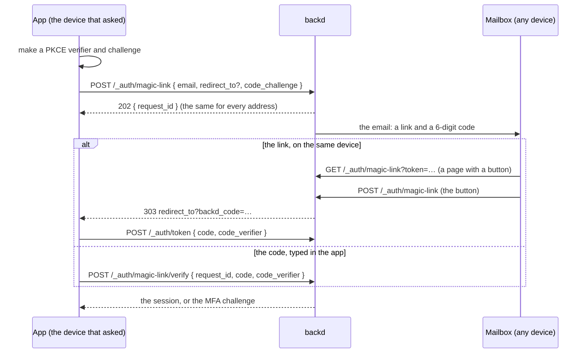

A **magic link** signs a user in with nothing but their mailbox. The email carries **a link** (opened on the device that asked) and **a 6-digit code** (typed in the app that asked, on any device); either one works, once, for 10 minutes. It is one more first factor, next to a [password](../sessions/) and [providers](../providers/): a user with a [second factor](../mfa/) is still asked for it.

It proves the same thing a [password reset](../sessions/#password-reset) does (control of the mailbox), so it is as strong as that.

```yaml
# realm.yaml: needs the email: section, and BACKD_SECRETS_KEY on the instance
magic_link:
  enabled: true
  signup: false        # true: an address with no account may make one (verified) this way
sign_in:
  allowed_redirects: [https://app.acme.example, "acme://"]
  app_url: https://app.acme.example/signed-in      # where a link goes without redirect_to
```

## The flow



1. **Ask.** `POST /_auth/magic-link` with `{"email", "code_challenge", "redirect_to"?, "locale"?}`. `code_challenge` is the S256 challenge of a verifier only your app holds, as in the [provider flow](../providers/#the-flow). The answer is always `202 {"request_id"}`.
2. **The email** has the link and the code. Redeeming either one uses up the request, so the other stops working.
3. **The link** opens a page of `backd` with a button (`pages/magic-link/<locale>.html`, or the built-in one). Opening it **never** uses the link up, so a mail scanner that follows links can't spoil it; only the button does. The button sends the browser to `redirect_to` (else `sign_in.app_url`) with the one-time login code in **`backd_code`**, bound to your app's PKCE challenge, which the app redeems at `POST /_auth/token` as for a provider. A link with nowhere to go (no `redirect_to`, no `app_url`) shows a page that says to type the code, and isn't used up.
4. **The code** is typed in the app, which sends it with its `request_id` and **`code_verifier`**: the code works only in the app that asked. Five wrong tries end the request.

An app that uses the [JavaScript client](../../clients/js/) needs no return route: the client sends the current page as `redirect_to` and finishes the sign-in when the page loads (see [Sign in with providers](../providers/)).


Opening the link on a phone while the app waits on a laptop lands on a page that has no verifier. The JavaScript client reports it as `wrong_device`; show "open it on the device where you asked, or type the code from the email".


## Who can use it

| The address | What happens |
|---|---|
| belongs to a user | the link or code signs them in; an unverified address becomes **verified** (only the mailbox's owner could have used it) |
| has no account, `magic_link.signup: true` and the realm's `signup: open` | the account is made **when the link or code is used**, never at request time: verified, with `new_user: true`, running [`account.on_signup`](../providers/#the-profile-and-the-sign-up-hook) |
| has no account otherwise | a `no-account` email ("someone tried to sign in with this address; there is no account") |
| belongs to a disabled or erased user | nothing is sent |

The answer to a request is **the same for all of them**, in about the same work, so it says nothing about who is registered. Requests use the [email limits](../../functions/email/#limits) (per recipient and per address); a limit that is reached isn't told either.

Users who sign in by link get an **`email` sign-in method** the first time (shown in `GET /_auth/me`), so the rule that a user always keeps one way to sign in sees it like any other. The account rules apply as at any sign-in: `login_networks`, disabled users, and the second factor.

## Errors

| Status and `code` | When |
|---|---|
| `400 validation_error`, `400 invalid_redirect` | A bad address, challenge or `redirect_to` (never about the account) |
| `400 invalid_code` | The code or the verifier is wrong (`attempts_left` in `details`) |
| `400 invalid_magic_link` | An unknown, used, expired or exhausted request |
| `403 signin_refused`, `403 signup_closed` | The account can't sign in; sign-up by link isn't allowed |
| `403 magic_link_disabled` | The realm doesn't have magic links |
| `429` | Too many tries from one address |

The button's redirect carries `backd_error=signin_refused` or `signup_closed` instead of a code.
