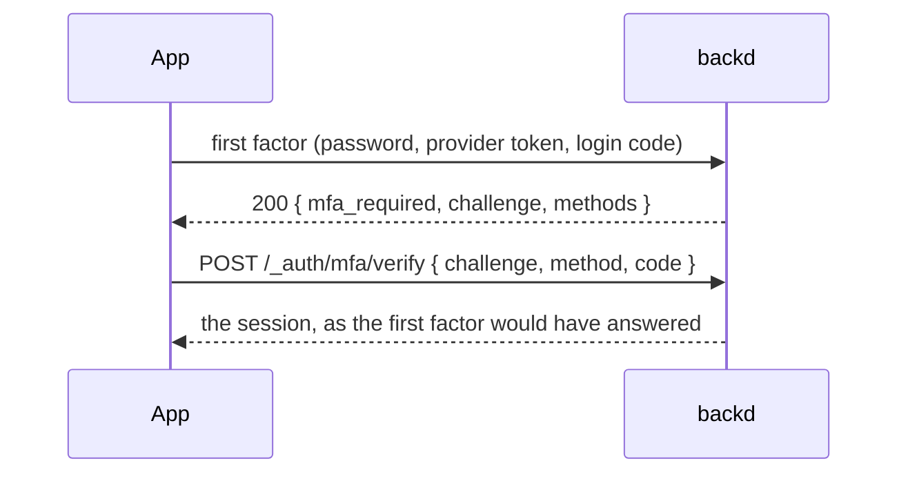

A realm can ask for a **second factor** after the first one. The first factor is whatever the user used to say who they are: a password, a [provider](../providers/) or (later) a magic link. The second factor is a one-time code from an authenticator app, or one of ten recovery codes.

The second step is built **once** and shared by every first factor, so a user with MFA is asked for a code whether they signed in with a password or with Google.

## Turning it on

```yaml
# realm.yaml
mfa:
  enabled: true      # default; false: users can't turn a second factor on
  issuer: Acme       # the name authenticator apps show (default: the realm's name)
```

Users manage their own second factor with their session, after a fresh [proof of identity](../reauth/) (`X-Backd-Reauth`): without one these answer `401 reauth_required`, so a stolen session can't turn a second factor on with the thief's phone and lock the user out.

| Endpoint | What it does |
|---|---|
| `GET /_auth/mfa` | `{ available, enabled, methods, recovery_codes_left, required }` (no proof needed) |
| `POST /_auth/mfa/totp/setup` | Makes a secret, kept 15 minutes: `{ setup_id, secret, otpauth_uri, qr, expires_at }`. `qr` is a PNG data URI to show as an ``; `secret` is for typing in |
| `POST /_auth/mfa/totp/confirm` | `{ setup_id, code }`: the first code of the app turns TOTP on and answers with the `recovery_codes`, **once** |
| `DELETE /_auth/mfa/totp` | Turns it off and deletes the recovery codes; `403 mfa_required_by_role` while a role of the user requires it |
| `POST /_auth/mfa/recovery-codes` | Replaces the 10 recovery codes with new ones, shown once |

- The secret is SHA-1, 6 digits, 30 seconds, 160 bits: what every authenticator app supports. It is stored **encrypted** with the realm's key (`BACKD_SECRETS_KEY`), and the recovery codes only as **keyed hashes**: not even backd can show them again.
- **Recovery codes** are ten of ten characters (`xxxxx-xxxxx`, without `0`, `O`, `1`, `I` or `L`), each good once. Save them somewhere other than the phone with the app.
- **Enabling ends the user's other sessions**, so a session from before can't pass a rule that asks for `user.mfa`. The session that enabled it stays.
- A setup allows 5 wrong codes and then ends; a new setup replaces a pending one.


Enrolling needs the instance to have `BACKD_SECRETS_KEY`: the TOTP secrets are encrypted with it. Without it, `available` is `false` and setting TOTP up answers `503 mfa_unavailable`.


### Notices

Each change sends a `security-notice` email (when the realm has [`email`](../../functions/email/)), and three wrong codes after a right password send `mfa-failed`, at most once an hour. They are written by `backd template realm` like the other emails; when the realm's folder has none, the built-in English text is used.

| Event | When |
|---|---|
| `mfa-enabled` | TOTP was confirmed |
| `mfa-disabled` | TOTP was turned off |
| `recovery-codes-regenerated` | the codes were replaced |
| `recovery-code-used` | a recovery code signed in (with the number left) |
| `mfa-failed` | 3 wrong codes after a correct password: "your password was used; change it" |

These are audited too: `user.mfa_enabled`, `user.mfa_disabled`, `user.recovery_codes_regenerated`, `user.recovery_code_used`, never the codes.

## Required by role

```yaml
mfa:
  required_roles: [admin, finance]     # roles that must use it, or `all`
```

- A user holding one of the roles (or any user, with `all`) who has no second factor gets `mfa_enrollment_required` and a challenge after the first factor. The challenge allows only two things, **without a session**:
  1. `POST /_auth/mfa/totp/setup` with `{"challenge"}` answers like the signed-in setup;
  2. `POST /_auth/mfa/totp/confirm` with `{"challenge", "setup_id", "code"}` turns it on and answers with the **session** and the `recovery_codes`. The session's `methods` include `totp`.
- The enrollment challenge lives 5 minutes and allows 5 wrong codes, like a challenge for a code.
- **Existing sessions** of such users keep working until they expire; nothing is revoked when a role starts to require MFA or a user is given such a role. Their next sign-in enrolls them. `backd user mfa-status --realm <realm>` lists who has not yet.
- A user in a required role can't turn the second factor off (`403 mfa_required_by_role`).
- At startup, outside dev mode, `backd` warns about admin roles that `required_roles` doesn't cover.


`required_roles` must name roles the realm declares, and conflicts with `mfa.enabled: false`: both are startup errors.


## When a user loses it

A user who lost the authenticator **and** the recovery codes needs an **administrator**:

```sh
backd user mfa-reset --realm acme --email ada@example.com --yes
# POST /_admin/users/{id}/mfa/reset
```

- It removes the TOTP secret and the recovery codes, **ends every session** of the user, sends them an `mfa-reset` email and is audited as `user.mfa_reset` with the administrator as the actor. A user in a [required role](#required-by-role) sets one up again at their next sign-in.
- It needs the `users` [admin area](../admin/), and it is **never available on yourself** (`403 self_reset_not_allowed`): an administrator who is the only one of the realm can't lock themselves out of the way back, but can't talk themselves in either.
- **Break glass.** For the only administrator of a realm who lost their factor, an operator with access to the instance runs `backd user mfa-reset --local --realm acme --email … --yes` where `backd` runs (it needs `CONFIG_DIR` and `MONGO_URI`, like `backd bootstrap`). It acts on the database directly and is audited as the actor `instance`.
- **There is no reset by email**: anyone who controls a mailbox would be able to remove the second factor that protects the account. A recovery flow with a waiting period is a possible future addition.

## How a sign-in goes



What a first factor answers depends on the user:

| The user | The answer |
|---|---|
| has no second factor, and no role requires one | the session, as always |
| has a second factor | `200 { "mfa_required": true, "challenge": "…", "methods": ["totp", "recovery_code"] }` |
| holds a role the realm requires MFA for, and has no second factor yet | `200 { "mfa_enrollment_required": true, "challenge": "…" }` |

The first factors that can end in a challenge are `POST /_auth/login`, `POST /_auth/signup` (a new user in a required role), the redemption of a provider's [login code](../providers/#the-flow) (`POST /_auth/token`) and `POST /_auth/oauth/{provider}/id-token`. A challenge is **only** given after the first factor was right, so it says nothing about accounts to someone who doesn't have it.


It carries no token, sets no cookie and is accepted by nothing but `POST /_auth/mfa/verify` (and, for `mfa_enrollment_required`, the enrollment of a second factor). Don't store it as a session in your app.


### Verifying

```sh
curl -X POST "$API/v1/acme/_auth/mfa/verify" -H 'Content-Type: application/json' \
  -d '{"challenge": "…", "method": "totp", "code": "492039"}'
# → the session, like a login's; a provider's also has new_user and profile
```

- `method` is `totp` (the six digits of the authenticator app) or `recovery_code` (`xxxxx-xxxxx`). A recovery code ends the sign-in too, and the answer says how many are `recovery_codes_left`.
- The answer is the first factor's own: the session JSON of a login, or of a provider sign-in with `new_user` and `profile`. `{"cookie": true}` works as it does for a login.
- A challenge lives **5 minutes** and allows **5 attempts**.

| Status and `code` | When |
|---|---|
| `400 invalid_code` | The code is wrong; `details[0]` has the `attempts_left` |
| `400 invalid_challenge` | The challenge is unknown, used, expired or out of attempts: one answer for all of them |
| `429 mfa_locked` | 10 wrong codes for the user in an hour, across challenges: nothing is tried for 15 minutes (`Retry-After`) |
| `429 too_many_requests` | The login throttle (per address) of the address |

A time step of a TOTP code is accepted **once**, and an older step can't follow a newer one, so a code seen by someone else is useless. There is no lockout that needs an administrator: waiting always works.

## How the session remembers

A session records how it was created: its `methods` are the first factor and, with a second one, `totp` or `recovery`; `mfa` says a second factor was used. Refreshing the session keeps them.

Rules and functions see them:

```yaml
rules:
  read: user != nil && user.mfa && hasRole(user, "finance")
  write: user != nil && "google" in user.methods
```

| In | Name | Value |
|---|---|---|
| [rules](../rules/) | `user.mfa`, `user.methods` | `true` when a second factor was used; the list of methods |
| [functions](../../functions/writing/) | `ctx.user.mfa`, `ctx.user.methods` | the same; a function's own data calls see the session's too |

An **API key** (also when acting on behalf of a user with `X-Backd-On-Behalf-Of`) is never MFA: `user.mfa` is `false` and `user.methods` is `["key"]`. Sessions that began before methods were recorded have none, so a rule that requires `user.mfa` asks those users to sign in again.

Anonymous callers have no `user`: guard with `user != nil &&` as with any other field.
