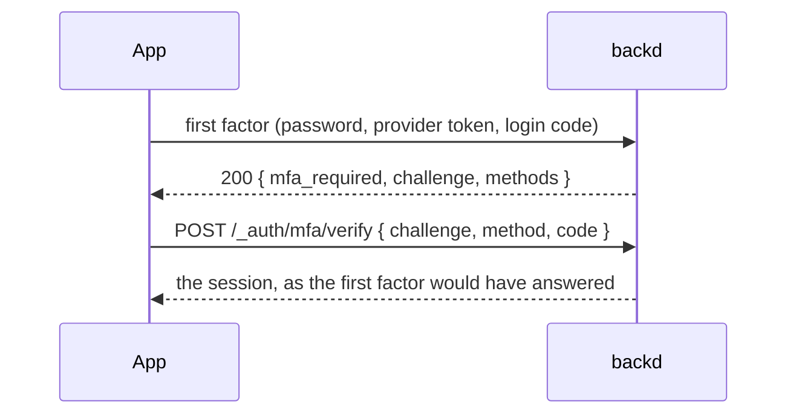

A realm can ask for a **second factor** after the first one. The first factor is whatever the user used to say who they are: a password, a [provider](../providers/) or (later) a magic link. The second factor is a one-time code from an authenticator app, or one of ten recovery codes.

The second step is built **once** and shared by every first factor, so a user with MFA is asked for a code whether they signed in with a password or with Google.

## How a sign-in goes



What a first factor answers depends on the user:

| The user | The answer |
|---|---|
| has no second factor, and no role requires one | the session, as always |
| has a second factor | `200 { "mfa_required": true, "challenge": "…", "methods": ["totp", "recovery_code"] }` |
| holds a role the realm requires MFA for, and has no second factor yet | `200 { "mfa_enrollment_required": true, "challenge": "…" }` |

The first factors that can end in a challenge are `POST /_auth/login`, `POST /_auth/signup` (a new user in a required role), the redemption of a provider's [login code](../providers/#the-flow) (`POST /_auth/token`) and `POST /_auth/oauth/{provider}/id-token`. A challenge is **only** given after the first factor was right, so it says nothing about accounts to someone who doesn't have it.


It carries no token, sets no cookie and is accepted by nothing but `POST /_auth/mfa/verify` (and, for `mfa_enrollment_required`, the enrollment of a second factor). Don't store it as a session in your app.


### Verifying

```sh
curl -X POST "$API/v1/acme/_auth/mfa/verify" -H 'Content-Type: application/json' \
  -d '{"challenge": "…", "method": "totp", "code": "492039"}'
# → the session, like a login's; a provider's also has new_user and profile
```

- `method` is `totp` (the six digits of the authenticator app) or `recovery_code` (`xxxxx-xxxxx`). A recovery code ends the sign-in too, and the answer says how many are `recovery_codes_left`.
- The answer is the first factor's own: the session JSON of a login, or of a provider sign-in with `new_user` and `profile`. `{"cookie": true}` works as it does for a login.
- A challenge lives **5 minutes** and allows **5 attempts**.

| Status and `code` | When |
|---|---|
| `400 invalid_code` | The code is wrong; `details[0]` has the `attempts_left` |
| `400 invalid_challenge` | The challenge is unknown, used, expired or out of attempts: one answer for all of them |
| `429 mfa_locked` | 10 wrong codes for the user in an hour, across challenges: nothing is tried for 15 minutes (`Retry-After`) |
| `429 too_many_requests` | The login throttle (per address) of the address |

A time step of a TOTP code is accepted **once**, and an older step can't follow a newer one, so a code seen by someone else is useless. There is no lockout that needs an administrator: waiting always works.

## How the session remembers

A session records how it was created: its `methods` are the first factor and, with a second one, `totp` or `recovery`; `mfa` says a second factor was used. Refreshing the session keeps them.

Rules and functions see them:

```yaml
rules:
  read: user != nil && user.mfa && hasRole(user, "finance")
  write: user != nil && "google" in user.methods
```

| In | Name | Value |
|---|---|---|
| [rules](../rules/) | `user.mfa`, `user.methods` | `true` when a second factor was used; the list of methods |
| [functions](../../functions/writing/) | `ctx.user.mfa`, `ctx.user.methods` | the same; a function's own data calls see the session's too |

An **API key** (also when acting on behalf of a user with `X-Backd-On-Behalf-Of`) is never MFA: `user.mfa` is `false` and `user.methods` is `["key"]`. Sessions that began before methods were recorded have none, so a rule that requires `user.mfa` asks those users to sign in again.

Anonymous callers have no `user`: guard with `user != nil &&` as with any other field.
