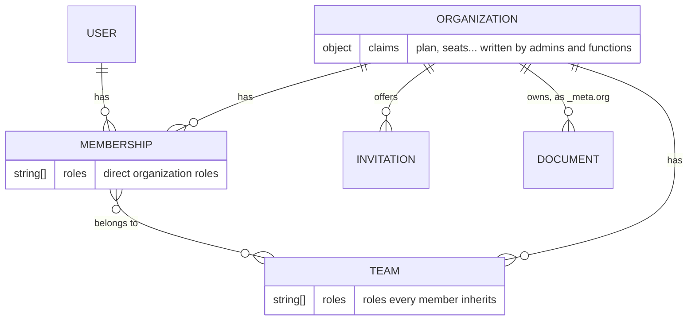
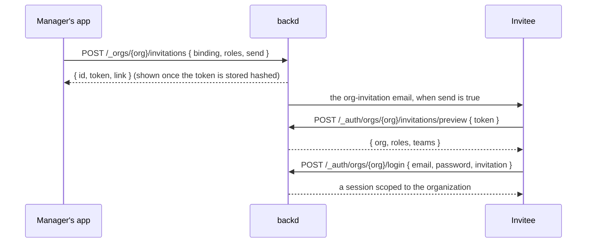
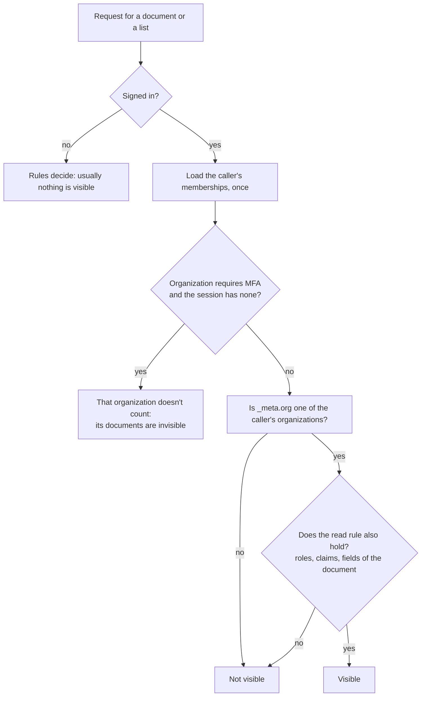

A B2B app needs "administrator of **this** customer, and only of this one". Realm roles are realm-wide, and a list of member ids on each document doesn't say who belongs to a customer or what they may do there. **Organizations** are backd's answer: groups of users, owned by backd like users are, that documents can belong to and that rules can ask about.

An organization is whatever a group of users is in your app: a company in a B2B product, a workspace, a club, a project — like GitHub's organizations, which aren't companies but any group of people with something in common. The docs and the API say **organization** everywhere the feature is meant; where an example says *company*, it means an organization that happens to be one.

A company can also sign its people in with its own Google Workspace or Microsoft tenant, and have them join the organization on the way in: see [the sign-in guide](sign-in/).

This page explains the pieces. The rest of the section puts them to work: [where documents live](where-documents-live/), [the sign-in experience](sign-in-experience/), [build a B2B app](build-a-b2b-app/), [rules cookbook](rules-cookbook/) and [what happens when…](what-happens-when/). For departments and delegation there is a second layer, [team roles](team-roles/), with [recipes](team-access-recipes/) and a [worked example](hr-absences/); [membership hooks](membership-hooks/), [organization context](organization-context/) and [organization email templates](email-templates/) complete it. The endpoints are in the [organizations API](api/) and the settings in [`realm.yaml`](../configuration/realm/#organizations) and [`collection.yaml`](../configuration/config-dir/#organizations).

## The model

- **An organization** has a name, a unique slug, a status (`active`, `orphaned` when nobody can manage it any more, `deleted`) and optional [claims](#claims).
- **A membership** says that a user belongs to an organization, with the roles they were given there.
- **A team** is a group of members that carries organization roles.
- **A document** belongs to one organization when its collection says so, recorded in `_meta.org`.

Everything lives in the realm's system database. An organization exists in one realm, and users, memberships and documents never cross realms.

## Realm roles and organization roles

| | Realm roles | Organization roles |
|---|---|---|
| Declared in | `realm.yaml` `roles:` | `realm.yaml` `organizations.roles:` |
| Meaning | the same in the whole realm | only inside one organization |
| Held by | users, given by administrators | members, given by the organization's managers |
| Checked with | `hasRole(user, 'editor')` | `hasOrgRole(document._meta.org, 'editor')` |
| What they open | the [admin API areas](../../operate/administration/admin/) | `manage: [org, members, roles, teams, sso]` inside the organization |

The two never mix. An organization or a team can't carry a **realm** role, so nobody becomes a realm administrator by joining the right team, and a realm role grants nothing inside an organization. Realm administrators act through the [admin API](../api/documents/#fixing-data-as-an-administrator), not by being members.

## Who sets `_meta.org`

Only backd, and only when a document is created: the document takes the organization of the session that creates it, and the create rule runs after that. A client can't write `_meta`, and `PUT` or `PATCH` with a different `_meta.org` answers `400 immutable_field`. Moving a document to another organization is [a realm administrator's job](../api/documents/#fixing-data-as-an-administrator).

Which collections belong to organizations is a decision of each collection:

| `organization:` | Creating a document | Documents |
|---|---|---|
| `required` | takes the session's organization | all belong to one |
| `optional` | may take it | some do |
| `none` (default) | belongs to none | none do |

## Effective roles

What a member may do in an organization is the union of three sources, resolved once per request and never cached, so a change applies at the next request:

1. **Direct roles**, given to the member in that organization.
2. **Team roles**, the roles of every team they belong to.
3. **Default roles**, `organizations.default_roles`, held by every member without being granted.

The members list returns each effective role with where it came from (`direct`, `default` or the team's name), and marks in `overlap` a role held more than one way. Rules see the effective roles only, never team names: `hasOrgRole(org, 'editor')`.

### Direct roles or teams?

Both can give the same role, and mixing them for the same purpose is a trap: a member with `editor` directly **and** through the "Editors" team keeps `editor` after being taken out of the team, so the removal looks done and isn't. "Who can edit?" also becomes a question with two places to look.

- **Management roles directly** (`owner`, `admin`): few people, each one a decision.
- **Access roles through teams** (`editor`, `viewer`): many people, one place to look.
- **Small organizations** may use direct roles only. That is fine, as long as it is one way.

## Claims

Claims are facts about an organization that **rules can read and members can't write**: `plan`, `seats`, `features`. Only realm administrators and functions set them, up to 1 KiB, so a rule can trust them. Profiles, addresses and anything the members edit belong in a collection of your own. See [limiting by plan](rules-cookbook/#limit-by-plan-with-claims).

## Invitations

People join by accepting an invitation, which a manager creates with the roles or teams it gives. Three bindings decide who may accept:

| Binding | Use it when | Who can accept |
|---|---|---|
| `user` | you know the person's account | that user only |
| `email` | you know their address, not whether they have an account | the signed-in user whose **verified** address matches |
| `none` | you share a link in a chat or a QR code | anyone signed in who holds the link; single use by default, expires in at most 30 days, never gives a managing role |

The link is shown only when the invitation is made. There is no hosted accept page: your app reads the token from the link, previews it, and the person signs in to the organization with it (or signs up, with a new account), which makes them a member.

## Who can see a document

For a collection in organizations, a read goes through the caller's memberships. Because the rules are applied inside the database query, a non-member doesn't get a "forbidden" for another organization's documents: they never see them, in lists, counts or by guessing ids.

## Deleting an organization and erasing a member

They are different operations with different consequences:

| | Delete an organization | Erase a member |
|---|---|---|
| Triggered by | a manager (with re-authentication) or a realm administrator | the user, or an administrator, under [erasure](../../operate/administration/erasure/) |
| Access | ends at once for everybody | ends at once for that user |
| Documents | each collection's `on_org_delete`: `delete` removes them, `keep` leaves them for administrators | stay with the organization, with the owner cleared, unless the collection says `on_owner_delete.in_org: apply` |
| The organization | kept as a `deleted` record | stays; becomes `orphaned` if the erased user was its last manager |
| Undo | an administrator can reactivate it, without members; `delete` documents are gone | no |

The content of an organization is the organization's, not its authors': erasing a person doesn't delete what their organization works with.
