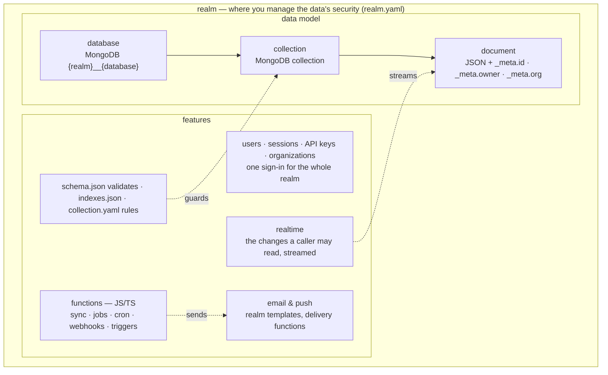

`backd` is an open-source (MIT), config-driven backend: one stateless Go service over MongoDB. You declare **realms**, **databases** and **collections** as files on disk (a JSON Schema per collection, optional indexes and access rules) and `backd` serves a schema-validated, queryable REST API for them, with built-in users and sessions, API keys, an admin API, and [server-side functions](../build/functions/) for the logic clients can't be trusted with.

Core concepts:



- **A realm is where you manage the data's security** — the authority everything inside shares. Users, sessions, API keys, organizations, email templates and secrets belong to one realm, so a realm can be a whole application, or a group of applications that share the same users and get single sign-on across their databases, or a part of an app you want apart by design (a public area next to a private one). Nothing crosses the boundary: the users of one realm never sign in to another, so one `backd` instance can safely serve several unrelated realms. `realm.yaml` holds the realm's settings.
- **A database groups a realm's collections.** Split them however it helps: `main` for the app's data, another for notifications or logs. It is stored as the MongoDB database `<realm>__<database>`, so anything that speaks MongoDB sees the data laid out plainly.
- **A collection holds documents of one shape.** Its `schema.json` validates every write, `indexes.json` declares the indexes and `collection.yaml` says who may read, write or delete. It is stored as one MongoDB collection.
- **A document is a JSON object** in a collection: your fields, plus a server-owned `_meta.id` and `_meta` carrying timestamps, the owner, and the organization and team when they apply.
- **Users, sessions, API keys and organizations belong to the realm:** one sign-in reaches every database in it, with brute-force protection, invitations, a second factor and consents.
- **Functions are JS/TS in isolated Deno processes** — sync calls, background jobs, cron, webhooks and triggers — for the logic clients can't be trusted with.
- **Email and push** use the realm's templates and send through delivery functions you write.
- **Realtime streams** each caller the changes their rules let them read.

On disk, it is a tree of folders. A realm is a folder with a `realm.yaml`; every folder in it is a database, except `_realm`, which holds what the realm shows and configures (emails, pages, push and consent texts, app configuration) rather than data:

```
config/                         CONFIG_DIR
└── shop/                       a realm
    ├── realm.yaml              its settings: users, roles, sign-in, email, storage
    ├── _realm/                 email, pages, push, consents, compliance, config
    └── main/                   a database
        ├── orders/             a collection
        │   ├── schema.json     what a document may contain
        │   ├── indexes.json    its indexes
        │   └── collection.yaml who may read and write, files, triggers
        └── _functions/         server-side functions
```

[Data model](../build/configuration/config-dir/) explains each file.

## Who reads what

The documentation has three sections, one per role. Pick yours and stay in it: each links to the others only where you need them.

| You are… | You want to… | Start at |
|---|---|---|
| **A developer building an app** on backd | declare data, call the API, write functions | [Quickstart](../build/quickstart/), then the [Tutorial](../tutorial/) and [Build](../build/) |
| **An operator** running backd for others | deploy, secure, monitor, back up, upgrade | [Operate](../operate/) and the [hardening checklist](../operate/checklist/) |
| **A contributor** changing backd itself | build from source, run the tests, follow the workflow | [Contribute](../contribute/) |

Something not working? [Troubleshooting](../troubleshooting/) lists the messages you are most likely to meet and what they mean.


Realms with `auth: disabled` are open to anyone who can reach `backd`: never expose them to the internet. Before exposing any realm, go through the [hardening checklist](../operate/checklist/).


## What you get

- **Configuration as files.** Invalid config stops startup and names the file; `backd config check` runs the same checks in CI.
- **Schema-validated writes,** mirrored as a MongoDB validator, with field-level errors and optimistic concurrency (`ETag`, `If-Match`).
- **Queries without injection:** `where`, `order_by`, pagination and counts over an allowlisted query language.
- **Users, sessions and API keys** per realm, with brute-force protection, invitations, a second factor, consents and an audit trail.
- **Access rules** (`rules:` in `collection.yaml`) decided per document, with read rules applied inside the database query.
- **Server-side functions** in isolated Deno processes: sync calls, background jobs, cron schedules, webhooks, encrypted secrets, rate limits and a network allowlist.
- **Files, push, organizations and realtime:** S3-compatible storage per realm, FCM/APNs/Web Push senders, B2B teams and roles, and server-sent events of the changes a caller may read.
- **Clients:** [`backd-js`](../build/clients/js/) for browsers and Node, [`package:backd`](../build/clients/dart/) for Flutter and standalone Dart, generated [TypeScript or Dart types](../build/clients/types/) per realm, and a per-realm [OpenAPI document](../build/api/openapi/) for every other language.
- **A production path:** a tested [reference deployment](../operate/production/), a config fingerprint so every instance runs the same configuration, and signed releases.

## Where to go next

| I want to… | Go to |
|---|---|
| Run a realm in a few commands: binary, template, compose | [Quickstart](../build/quickstart/) |
| Build a whole app, chapter by chapter | [Tutorial](../tutorial/) |
| Describe my data and use the API: schemas, auth, functions, files, push | [Build](../build/) |
| Run and administer a deployment: providers, monitoring, backup, hardening | [Operate](../operate/) |
| Work on backd itself: workflow, the `make dev` stack, architecture | [Contribute](../contribute/) |
| See complete applications | [Examples](../build/examples/) |
