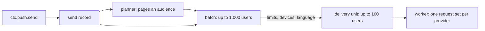

A function that declares [`push`](../../functions/reference/) in its `function.yaml` has `ctx.push.send`. The call answers at once; backd's workers deliver.

```ts
export default async function (ctx) {
  const r = await ctx.push.send({
    user: order.owner,                  // or users: [...], or audience (below)
    kind: "order-shipped",              // a template of the realm, or title + body (raw)
    data: { order_no: order.no, eta: "tomorrow" },
    group: `order-${order.id}`,
    priority: "high",
  });
  // r = { send_id: "ps_…", users: 1, jobs: 1, queued: 1, limited: 0, no_devices: 0 }
}
```

```yaml
# function.yaml
push: true                              # or push: { kinds: [order-shipped], audience: false }
```

## Who

Give exactly one of:

| Field | Reaches |
|---|---|
| `user` | One user, by id |
| `users` | Any number of users, by id. There is no per-call cap |
| `audience` | Users that match a filter, for a function with `push: { audience: true }`: `"all"`, or an object with `roles` (holding any of them), `email_verified`, `locale`, `created_before` and `created_after`. Disabled and erased users never match |

A list of a million ids can't go through a function call, which is what `audience` is for: backd pages through the matching users itself, so the audience is fixed batch by batch.

## What

`kind` names a [template](../#messages-and-templates); without it, `title` and `body` are the text (a *raw* message). The other fields (`link`, `data`, `badge`, `sound`, `group`, `ttl`, `priority`, `silent`, `platform`) are described with the [message](../#the-message). `data` values are strings. The message is rendered in every language of the realm and checked **before anything is queued**; a function that can't send gets an error it can show or let end it:

| Code | When |
|---|---|
| `unknown_push_kind` | The kind has no template, or the function didn't declare it |
| `invalid_push_message` | A field is not acceptable (the answer names it) |
| `payload_too_large` | A rendering is over a provider's limit |
| `push_audience_not_declared` | An audience without `push: { audience: true }` |
| `push_unavailable` (`503`) | A secret the providers need is not set |
| `push_not_configured` (`404`) | The realm has no `push:` section |

## What backd does with it



- **A batch** applies the limits, resolves each user's devices (only those whose session is still alive), picks each user's language and makes **delivery units** of up to 100 users. A send of up to 1,000 users is planned during the call, so the answer already says how many were `limited` or had `no_devices`; larger sends answer `null` for those and the counts appear on the send as batches run.
- **A delivery unit** carries device ids, never tokens: the worker loads and decrypts them when it runs. Each device gets a result:

| Result | Meaning | Effect |
|---|---|---|
| `sent` | The provider accepted it | Counted |
| `invalid` | The token is dead | The device is **removed** |
| `retry` | Throttled or transient | Only these devices are sent again, after the backoff |
| `failed` | Permanent for this push | Counted; the device stays |

A device the sender gave no result for counts as failed. A failure of the call as a whole (the network, rejected credentials) retries the whole unit under `push.delivery.retry`; devices already delivered in that attempt may get the push twice. After the last attempt, what is still pending counts as failed.

- **Idempotent planning.** If a worker dies mid-batch, the batch runs again from where it was: units have deterministic ids, so none is made twice and nobody is charged twice.


A function with `push` sends **as your realm**, to whoever it names. If anonymous or low-trust callers can invoke it, don't let them choose the recipients or the text: take the user from the caller's own session (`ctx.user.id`) or from your own data, keep the kind fixed, and gate it with an `invoke` rule. The per-user limits stop a flood on one phone, not a function that reaches everyone.


## Limits

Per user, `push.limits.per_user` (**5 a minute and 24 a day** by default), counted once per push however many devices the user has. **Silent pushes count too, and nobody is exempt:** there is no urgent flag and no administrator bypass. A user over their limit is skipped and counted as `limited`; there is no per-call cap, so very large sends are kept in check by batching, these limits and `push.delivery.parallelism`.

## `wait`

`wait: true` waits for the totals within the function's time limit and returns what it has then, with `sent`, `invalid`, `failed` and `completed`. Don't use it for large sends.


The jobs of a send hold the rendered message and the user ids until the realm's `functions.job_retention` expires them. The send's own [record](../records/) holds counts only: no title, body, data or token.

