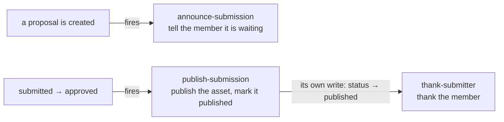

Until now every function ran because somebody called it or a clock fired. A **trigger** runs a function because a document *changed*, whoever changed it and from wherever. This chapter builds a small pipeline on a `submissions` collection: a member proposes an asset, a curator approves it, and the rest happens on its own.



## The collection



- `events` are `created`, `updated` and `removed`. `when` is an expression over `document`, `before` and `changed()`, so it reads the **transition**: writing `approved` again, or any other field, fires nothing.
- `fields` lists the document fields the job input carries; without it only the ids do. Triggers never carry the whole document.
- `session: true` adds `by`, the user whose write caused the event (`null` for a function's own write).
- `ordered: true` runs one document's jobs one at a time, in the order the changes happened.


A trigger needs a realm with authentication enabled: its function runs with the realm's admin access, and the rules above are what keeps a client from forging a transition.


## The steps



The function's own write (`status: published`) is an event too, **one level deeper**, and it is what fires `thank-submitter`. Each step is small and checks where the document stands now, because a delivery can repeat after a restart: the same change has the same event id and the same job id, so a replay collapses into the job that already exists, and what slips through is made harmless by that check.

The inputs are typed: `backd types` generates `SubmissionsTriggerInput`, and the trigger functions are typed with admin access automatically.

## Chains have a bound

Every write made by a trigger's function carries `_meta.chain = { root, depth }`: the first event's id and how many triggers deep it is. The pipeline above is depth 0 → 1 (publish) → 2 (thank). A realm stops a chain at `triggers.max_chain` (16 by default) and the dropped event is a **gap** you can see, never a silent loop.

## Test and debug

Test a trigger function with `fakeTrigger` from `@backd/functions-testing`; see [testing functions](../../build/functions/testing/). In a running realm:

```sh
backd functions history --function main/publish-submission   # each run, its input and result
backd triggers status                                        # lag, backlog, the lease holder
backd triggers gaps                                          # what could not be delivered
```

## You should see

- A member's `POST` with `status: "approved"` is `403`; a curator's change of anything but `submitted → approved` is `403`.
- Within seconds of a proposal the member has a notification; after the curator approves, the asset has `published_at`, the proposal is `published` with `decided_by` the curator, and the member has one thank-you.
- The proposal's history shows `_meta.chain.depth` 0 for the curator's write and 1 for the function's, both with the same `root`.

Read [Triggers](../../build/functions/triggers/) for the delivery guarantees, the cost and how to operate them.

Next: [chapter 24](../24-live-pins/) — live pins.
